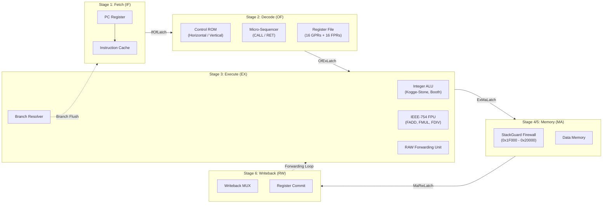
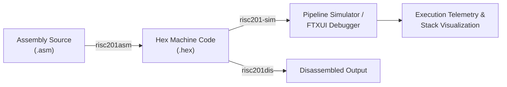

# RISC201 Pipelined Microprogrammed Processor

A cycle-accurate 32-bit RISC processor simulator developed in C++17 for CSC-201 (Computer Organization & Architecture). The design features 4-stage and 6-stage pipelined datapaths, microcode control memory with horizontal and vertical encodings, an IEEE-754 floating-point unit, hardware-enforced memory safety, a two-pass assembler/disassembler, and an interactive terminal debugger.

---

## Architecture Overview



### Core Specifications
- **Word Width:** 32-bit fixed-length instructions, 32-bit data words, byte-addressable / word-aligned memory.
- **Register Set:**
  - 16 General-Purpose Registers: `r0` (hardwired zero), `r1`–`r12` (general), `r13` (swap temporary), `r14` (`sp`, stack pointer), `r15` (`ra`, return address).
  - 16 Floating-Point Registers: `f0`–`f15` (IEEE-754 single-precision floats).
- **Status Flags:** `Z` (Zero), `N` (Negative), `C` (Carry), `V` (Overflow).
- **Pipelines:**
  - **4-Stage:** `[IF] -> [OF] -> [EX] -> [MA/RW]` (Low latency, 1-cycle load-use stall, inline memory checks).
  - **6-Stage:** `[IF] -> [OF] -> [EX] -> [MEMCHK] -> [MA] -> [RW]` (Decoupled memory firewall stage, 2-cycle load-use stall).
- **Control Unit:**
  - **Horizontal ROM (48-bit):** Direct uncompressed control signals, zero combinational decoding delay.
  - **Vertical ROM (24-bit):** Field-encoded control word with a combinational micro-decoder, cutting ROM storage by 50%.
- **Memory Safety:** Hardware `StackGuard` unit enforcing exclusive stack bounds (`0x1F000`–`0x20000`), word alignment (`addr % 4 == 0`), and illegal write suppression.

---

## Toolchain & Workflow



1. **Assembler (`risc201asm`):** Two-pass assembler with symbol resolution, section handling (`.text`, `.data`), and full-descending stack macro expansion (`PUSH`, `POP`, `SPUSH`, `SPOP`).
2. **Disassembler (`risc201dis`):** Single-pass binary/hex disassembler that reconstructs assembly mnemonics, operands, and memory offsets.
3. **Execution Simulator (`risc201-sim`):** Unified pipelined debugger supporting live stage latch inspection (`pipe`), IEEE-754 FPU registers (`fregs`), single-step (`s`), micro-cycle step (`mi`), reverse execution (`u`), breakpoints (`b`), and full-screen terminal UI (`--tui`).
4. **Test Suite (`risc201-tests`):** Automated regression suite with 48 test targets and an 80-case runtime safety matrix covering pipeline hazards, control ROM, gate-level arithmetic, memory safety, and toolchain continuity.

---

## Performance Evaluation

Cycle counts, instruction retirement, and CPI measured across our cycle-accurate benchmarks:

| Benchmark | Pipeline | Control ROM Encoding | Cycles | Instructions | CPI | Speedup vs Baseline | Stalls / Flushes |
| :--- | :--- | :--- | :---: | :---: | :---: | :---: | :---: |
| **Recursive Fibonacci ($N=10$)** | 4-Stage | Horizontal (48-bit) | 3,597 | 1,825 | 1.97 | 5.07x | 1,415 |
| | 4-Stage | Vertical (24-bit) | 3,597 | 1,825 | 1.97 | 5.07x | 1,415 |
| | 6-Stage | Horizontal (48-bit) | 4,305 | 1,825 | 2.36 | 4.40x | 2,121 |
| | 6-Stage | Vertical (24-bit) | 4,305 | 1,825 | 2.36 | 4.40x | 2,121 |
| | *Single-Bus Baseline (4-Stage)* | *Microprogrammed* | *18,230* | *1,825* | *9.99* | *1.00x* | *N/A* |
| | *Single-Bus Baseline (6-Stage)* | *Microprogrammed* | *18,937* | *1,825* | *10.38* | *1.00x* | *N/A* |
| **Matrix Multiply + FPU ($2\times2$)** | 4-Stage | Horizontal (48-bit) | 315 | 229 | 1.38 | 7.31x | 83 |
| | 4-Stage | Vertical (24-bit) | 315 | 229 | 1.38 | 7.31x | 83 |
| | 6-Stage | Horizontal (48-bit) | 335 | 229 | 1.46 | 6.96x | 101 |
| | 6-Stage | Vertical (24-bit) | 335 | 229 | 1.46 | 6.96x | 101 |
| | *Single-Bus Baseline (4-Stage)* | *Microprogrammed* | *2,303* | *229* | *10.06* | *1.00x* | *N/A* |
| | *Single-Bus Baseline (6-Stage)* | *Microprogrammed* | *2,331* | *229* | *10.18* | *1.00x* | *N/A* |
| **Bubble Sort + Checksum** | 4-Stage | Horizontal (48-bit) | 818 | 606 | 1.35 | 7.09x | 209 |
| | 4-Stage | Vertical (24-bit) | 818 | 606 | 1.35 | 7.09x | 209 |
| | 6-Stage | Horizontal (48-bit) | 918 | 606 | 1.51 | 6.45x | 307 |
| | 6-Stage | Vertical (24-bit) | 918 | 606 | 1.51 | 6.45x | 307 |
| | *Single-Bus Baseline (4-Stage)* | *Microprogrammed* | *5,800* | *606* | *9.57* | *1.00x* | *N/A* |
| | *Single-Bus Baseline (6-Stage)* | *Microprogrammed* | *5,918* | *606* | *9.77* | *1.00x* | *N/A* |

**Observations:**
- The 4-stage pipeline achieves lower CPI (1.35–1.97) due to its 1-cycle load-use penalty.
- The 6-stage pipeline trades a small CPI increase for higher clock frequency potential and isolated hardware memory checking.
- The 24-bit Vertical ROM achieves **100% cycle-for-cycle parity** with the 48-bit Horizontal ROM across all benchmarks, proving that field compaction with combinational micro-decoding has zero penalty on execution throughput.
- Baseline 4-stage and 6-stage single-bus cycle counts are cleanly differentiated via accurate stage-layout parameter forwarding.

---

## Build & Run Guide

Build with GCC and CMake on Windows (MinGW64) or Linux:

```powershell
# 1. Configure the build
cmake -B build -G "MinGW Makefiles"

# 2. Compile all binaries
cmake --build build

# 3. Run all unit and regression tests (48/48 unit tests + 80/80 safety matrix cases)
.\build\risc201-tests.exe

# 4. Run CTest verification (6/6 suites including toolchain integration)
ctest --test-dir build --output-on-failure

# 5. Assemble an example program
.\build\risc201asm.exe .\tests\programs\fib.asm fib.hex --hex

# 6. Disassemble hex back to assembly
.\build\risc201dis.exe fib.hex

# 7. Run interactive FTXUI terminal debugger (with live pipeline latches and FPU registers)
.\build\risc201-sim.exe --tui
```

---

## Team Ownership

```
Monolith/
├── control_unit/           # Garv      - Microcode ROMs, Sequencer, Pipeline Datapath & Bundles
├── simulator_core/         # Aditya    - Core CPU stepping, Memory/Registers, FTXUI Terminal UI
├── memory/                 # Aditya    - Physical MemoryUnit, word read/write, write-journaling
├── alu/ & fpu/             # Atharva   - Kogge-Stone Adder, Booth Multiplier, Divider, IEEE-754 FPU
├── memory_safety/          # Paras     - StackGuard firewall, Memory Exception Framework, ASCII Visualizer
├── assembler_disassembler/ # Saatvik   - Standalone CLI (risc201asm/dis) & Modular Assembler Library
├── isa_spec/               # Shared    - Canonical ISA definitions & opcode mappings
├── tests/                  # Shared    - Benchmark suite and safety regression matrix
└── docs/                   # Shared    - Architecture specifications & editable Draw.io schematics
```

---

## Course Requirements Checklist

| Requirement | Implementation | Status |
| :--- | :--- | :---: |
| **1.1** 4-stage and 6-stage processor design & comparison | Implemented in `PipelineProcessor`. Quantitative comparison across 3 benchmarks documented. | Completed |
| **1.2** Microprogrammed Control Unit (Horizontal / Vertical) | Both implemented: 48-bit Horizontal ROM vs. 24-bit Vertical ROM with micro-decoder. | Completed |
| **1.3** Optimized ALU operations | 32-bit Kogge-Stone Adder, Radix-4 Booth Multiplier, Non-Restoring Divider, and IEEE-754 FPU. | Completed |
| **2.1** Two-pass assembler | `risc201asm` CLI tool with symbol table resolution and hex/binary output. | Completed |
| **2.2** Disassembler | `risc201dis` CLI tool reconstructing instructions from word streams. | Completed |
| **2.3** Interactive CLI simulator & pipeline inspection | Debugger with register/memory dumps, breakpoints, and reverse step-back. | Completed |
| **2.4** Step-by-step CPU debugger with TUI | Full terminal interface using FTXUI (`risc201-sim --tui`). | Completed |
| **2.5** Stack preprocessor macro expansion | `PUSH`, `POP`, `SPUSH`, `SPOP` full-descending stack macros. | Completed |
| **2.6** Stack safety verification & runtime exceptions | `StackGuard` bounds checking on `r14` (`sp`), alignment check, illegal write suppression. | Completed |
| **2.7** Active stack memory visualizer | Live ASCII frame renderer with stack frame markers. | Completed |
| **3** Microcode execution in CPU simulator | Control Memory ROMs drive execution; micro-PC state displayed step-by-step. | Completed |
| **4** Optimized ALU class integrated into simulator | `risc201_alu` and `risc201_cu` linked into simulator engine. | Completed |
| **5** Comprehensive evaluation across test cases | Evaluated on Fibonacci, Matrix Multiply with FPU, and Bubble Sort across all pipeline/ROM modes. | Completed |

---

## Documentation Index

- **[`docs/architecture.md`](./docs/architecture.md):** Complete hardware specification, datapath stages, and microcode ROM bitfields.
- **[`docs/pipeline.md`](./docs/pipeline.md):** Pipeline latches, forwarding unit logic, and hazard detection interlocks.
- **[`docs/diagrams/pipeline_datapath.drawio`](./docs/diagrams/pipeline_datapath.drawio):** Editable vector schematic openable in VS Code or [draw.io](https://app.diagrams.net).
- **[`docs/isa.md`](./docs/isa.md):** Canonical 34-opcode ISA table, instruction formats, and register conventions.
- **[`docs/memory_safety.md`](./docs/memory_safety.md):** Memory safety subsystem, StackGuard rules, and exception vectors.
- **[`docs/tui.md`](./docs/tui.md):** Interactive FTXUI terminal debugger manual.
- **[`docs/plan.md`](./docs/plan.md):** Project progress changelog and module integration roadmap.
