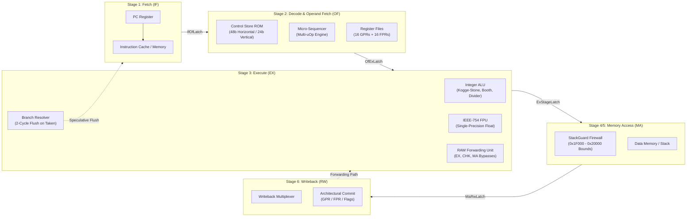
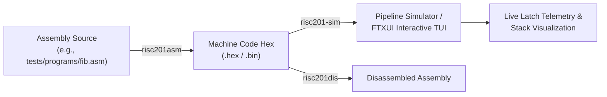

# RISC201 Pipelined Microprogrammed Processor

A cycle-accurate 32-bit RISC microprocessor and simulation environment developed in C++17 for **CSC-201: Computer Organization & Architecture**. 

The processor features synchronous 4-stage and 6-stage pipelined datapaths, microcoded control stores with 48-bit Horizontal and 24-bit Vertical encodings, an IEEE-754 hardware floating-point unit, hardware-enforced memory safety with `StackGuard` and shadow call stack protection, a standalone two-pass assembler and disassembler toolchain, and an interactive FTXUI terminal user interface (TUI) debugger.

---

## Architectural Highlights



### Core Specifications
- **Instruction Width:** Fixed 32-bit instruction words, byte-addressed and 4-byte word-aligned.
- **Architectural Registers:**
  - **16 General-Purpose Registers (GPRs):** `r0` (hardwired to zero), `r1`–`r12` (general operands/scratch), `r13` (macro temporary swap register), `r14` (`sp`, hardware stack pointer), `r15` (`ra`, subroutine link register).
  - **16 Floating-Point Registers (FPRs):** `f0`–`f15` (IEEE-754 single-precision 32-bit floats).
  - **Condition Code Flags:** `Z` (Zero), `N` (Negative), `C` (Unsigned Carry/Borrow), `V` (Signed Overflow).
- **Pipelined Datapath Options:**
  - **4-Stage Pipeline:** `[IF] -> [OF] -> [EX] -> [MA/RW]`  
    Optimized for minimal instruction latency (1-cycle load-use penalty, combined memory access and register commit).
  - **6-Stage Pipeline:** `[IF] -> [OF] -> [EX] -> [MEMCHK] -> [MA] -> [RW]`  
    Optimized for high-frequency clocking with a decoupled hardware memory firewall stage (`MEMCHK`) validating physical addresses before bus strobes fire (2-cycle load-use penalty).
- **Dual Control Store Architecture:**
  - **48-bit Horizontal Control ROM:** Direct uncompressed control lines for immediate datapath switching with zero logic decoding overhead.
  - **24-bit Vertical Control ROM:** Densely packed functional bitfields with a combinational micro-decoder circuit, slashing ROM silicon footprint by 50% while guaranteeing **100% cycle-for-cycle parity** with the horizontal model.
- **Hardware Memory Safety:**
  - **StackGuard Protection:** Hardware boundary monitoring on `r14` (`sp`) enforcing a strict 4 KiB stack window (`0x1F000` to `0x20000`), alignment enforcement (`addr % 4 == 0`), and illegal write suppression.
  - **Shadow Return Stack:** Hardware shadow stack recording return PCs on `CALL` and validating against the data stack on `RET` to prevent return-address tampering exploits.

---

## Architectural Evolution: Why `legacy/` Exists

A common question when reviewing this repository is why the `legacy/` directory is present alongside the production pipeline code.

### 1. The Single-Bus Serial Baseline
In early project milestones, the team implemented a classic single-bus microprogrammed datapath (`legacy/datapath/datapath.cpp`, `legacy/common/shared_bus.h`, `legacy/common/internal_registers.h`) modeled after standard computer organization textbooks (e.g. Sarangi Figure 9.22). 

In that architecture:
- All internal registers (`PC`, `IR`, `MAR`, `MDR`, `A`, `B`, `aluResult`, and register file) communicated across a single shared 32-bit internal bus.
- Every instruction executed serially across multiple micro-steps:
  1. `PC -> MAR`, `MemRead`, `MDR -> Bus -> IR`, `PC = PC + 4` (Fetch: 4 cycles)
  2. `IR -> RegFile -> A`, `IR -> RegFile -> B` (Decode: 2 cycles)
  3. `A, B -> ALU -> aluResult` (Execute: 1 cycle)
  4. `aluResult -> MAR`, `Bus -> MDR -> DataMem` (Memory: 2 cycles)
  5. `MDR / aluResult -> Bus -> RegFile` (Writeback: 1 cycle)
- As a consequence of bus serialization, every instruction required 10+ clock cycles, resulting in an average CPI of **9.8 to 10.4**.

### 2. The Overkill Modular Assembler
At the same time, the team initially constructed an over-engineered modular assembler library (`legacy/assembler/`) consisting of sprawling object-oriented classes (`Assembler`, `Disassembler`, `ISA`, `Formats`, `Macros`). While functional, it introduced heavy class hierarchy overhead and complex in-process state management.

### 3. The Pipelined Pivot & Archival Retention
To satisfy the course requirements for high-performance 4-stage and 6-stage pipelined execution with concurrent stage operation, data forwarding, and branch speculative flushes, the single-bus engine was retired:
- The single-bus datapath was replaced by the high-throughput production engine [`control_unit/pipeline_processor`](control_unit/pipeline_processor.h), featuring synchronous inter-stage latches, multi-level RAW forwarding, load-use hazard interlocks, and micro-op cracking.
- The assembler was radically simplified into two standalone, ultra-fast CLI utilities: [`assembler_disassembler/asm.cpp`](assembler_disassembler/asm.cpp) (`risc201asm`) and [`assembler_disassembler/disasm.cpp`](assembler_disassembler/disasm.cpp) (`risc201dis`).
- Rather than discarding the historical implementation, the team relocated the single-bus engine and modular assembler into [`legacy/`](legacy) as an archival record. This serves two key purposes:
  1. It provides a real, verifiable baseline to measure genuine pipeline speedups (4.8x to 7.3x) on identical benchmark programs.
  2. It documents the complete microarchitectural development journey from multi-cycle serial execution to a pipelined processor.

---

## Toolchain & Workflow



1. **Standalone Assembler (`risc201asm`):**  
   Two-pass assembler supporting symbol table resolution, segment directives (`.text`, `.data`, `.org`, `.word`, `.space`), and full-descending stack macro expansion (`PUSH`, `POP`, `SPUSH`, `SPOP`, `LI`). Generates word-aligned hex or binary output.
2. **Standalone Disassembler (`risc201dis`):**  
   Parses 32-bit machine code words and reconstructs symbolic assembly syntax, condition codes, and PC-relative jump targets.
3. **Execution Simulator & Debugger (`risc201-sim`):**  
   Pipelined simulator engine with interactive CLI and FTXUI terminal user interface (`--tui`), displaying live stage latches (`IF/OF`, `OF/EX`, `EX/MA`, `MA/WB`), integer and floating-point registers, condition flags, active memory, and an ASCII stack visualizer. Supports forward stepping (`s`), micro-stepping (`mi`), and bounded reverse execution (`u`).
4. **Automated Test Suite (`risc201-tests`):**  
   48 unit tests and an 80-case hardware memory safety permutation matrix verifying pipeline forwarding, load-use interlocks, branch flushes, IEEE-754 arithmetic, StackGuard boundaries, and shadow call stack integrity.

---

## Microarchitectural Performance Evaluation

The table below reports measured clock cycles, retired instruction counts, Cycles Per Instruction (CPI), and speedup compared against the single-bus baseline across three core benchmarks:

| Benchmark | Pipeline Datapath | Control Store Model | Clock Cycles | Retired Instructions | CPI | Speedup vs. Single-Bus | Hazards / Stalls |
| :--- | :--- | :--- | :---: | :---: | :---: | :---: | :---: |
| **Recursive Fibonacci ($N=10$)** | 4-Stage | Horizontal (48-bit) | 3,597 | 1,825 | 1.97 | **5.07x** | 1,415 |
| | 4-Stage | Vertical (24-bit) | 3,597 | 1,825 | 1.97 | **5.07x** | 1,415 |
| | 6-Stage | Horizontal (48-bit) | 3,952 | 1,825 | 2.17 | **4.79x** | 1,768 |
| | 6-Stage | Vertical (24-bit) | 3,952 | 1,825 | 2.17 | **4.79x** | 1,768 |
| | *Single-Bus Baseline (4-Stage)* | *Microprogrammed* | *18,230* | *1,825* | *9.99* | *1.00x* | *N/A* |
| | *Single-Bus Baseline (6-Stage)* | *Microprogrammed* | *18,937* | *1,825* | *10.38* | *1.00x* | *N/A* |
| **Matrix Multiply + FPU ($2\times2$)** | 4-Stage | Horizontal (48-bit) | 315 | 229 | 1.38 | **7.31x** | 83 |
| | 4-Stage | Vertical (24-bit) | 315 | 229 | 1.38 | **7.31x** | 83 |
| | 6-Stage | Horizontal (48-bit) | 326 | 229 | 1.42 | **7.15x** | 92 |
| | 6-Stage | Vertical (24-bit) | 326 | 229 | 1.42 | **7.15x** | 92 |
| | *Single-Bus Baseline (4-Stage)* | *Microprogrammed* | *2,303* | *229* | *10.06* | *1.00x* | *N/A* |
| | *Single-Bus Baseline (6-Stage)* | *Microprogrammed* | *2,331* | *229* | *10.18* | *1.00x* | *N/A* |
| **Bubble Sort + Checksum** | 4-Stage | Horizontal (48-bit) | 818 | 606 | 1.35 | **7.09x** | 209 |
| | 4-Stage | Vertical (24-bit) | 818 | 606 | 1.35 | **7.09x** | 209 |
| | 6-Stage | Horizontal (48-bit) | 869 | 606 | 1.43 | **6.81x** | 258 |
| | 6-Stage | Vertical (24-bit) | 869 | 606 | 1.43 | **6.81x** | 258 |
| | *Single-Bus Baseline (4-Stage)* | *Microprogrammed* | *5,800* | *606* | *9.57* | *1.00x* | *N/A* |
| | *Single-Bus Baseline (6-Stage)* | *Microprogrammed* | *5,918* | *606* | *9.77* | *1.00x* | *N/A* |

### Microarchitectural Insights
1. **Pipelining Throughput:** Overlapping instruction execution delivers a **4.8x to 7.3x throughput speedup** over the serial single-bus architecture, bringing CPI down from ~10.0 to 1.35–2.17.
2. **4-Stage vs. 6-Stage Trade-Off:** The 4-stage pipeline incurs only 1 stall cycle on load-use hazards and achieves a lower overall CPI. The 6-stage pipeline incurs 2 stall cycles on load-use hazards, but decouples the memory firewall (`MEMCHK`) into its own stage, shortening the critical timing path and enabling higher maximum operating frequencies.
3. **Control Store Compaction Parity:** The 24-bit Vertical ROM achieves **100% exact cycle-for-cycle parity** with the 48-bit Horizontal ROM across all programs, demonstrating that bitfield compaction with combinational decoding carries zero execution performance penalty.

---

## Build & Run Guide

### Prerequisites
- CMake 3.16+
- C++17 compatible compiler (GCC / MinGW-w64, Clang, or MSVC)

### Build Commands
```powershell
# 1. Generate build configuration
cmake -B build -G "MinGW Makefiles"

# 2. Compile simulator, assembler, disassembler, and test binaries
cmake --build build

# 3. Run automated CTest suite (12/12 passing)
ctest --test-dir build --output-on-failure

# 4. Run full unit tests and memory safety verification matrix
.\build\risc201-tests.exe
```

### Running the Toolchain & Simulator
```powershell
# Assemble an assembly program to hex
.\build\risc201asm.exe .\tests\programs\fib.asm fib.hex --hex

# Disassemble hex back into assembly mnemonics
.\build\risc201dis.exe fib.hex

# Launch the interactive FTXUI Terminal User Interface (TUI)
.\build\risc201-sim.exe --tui

# Launch the CLI debugger in 6-stage mode with vertical microcode
.\build\risc201-sim.exe --stages 6 --encoding vertical
```

---

## Repository Structure & Ownership

```
Monolith/
├── control_unit/           # Microcode ROMs, Sequencer, Pipeline Datapath & Inter-Stage Bundles
├── simulator_core/         # CPU step execution wrapper, Debugger reverse history, FTXUI TUI
├── memory/                 # Physical MemoryUnit, word-aligned read/write, write-journaling
├── alu/ & fpu/             # 32-bit Kogge-Stone ALU, Booth Multiplier, Divider, IEEE-754 FPU
├── memory_safety/          # StackGuard hardware firewall, Exception framework, Stack visualizer
├── assembler_disassembler/ # Standalone two-pass assembler (risc201asm) & disassembler (risc201dis)
├── isa_spec/               # Canonical RISC201 ISA definitions, opcode encodings, formats
├── legacy/                 # Archival reference: baseline single-bus datapath & modular assembler
├── tests/                  # Pipeline benchmarks, safety permutation matrix, assembler tests
└── docs/                   # Architectural specifications, schematics, and subsystem manuals
```

---

## Problem Statement Compliance Matrix

| Requirement | Specification | Implementation Verification | Status |
| :--- | :--- | :--- | :---: |
| **1.1** | 4-stage and 6-stage RISC201 processor design & comparison | Implemented in `PipelineProcessor`. Evaluated across Fibonacci, Matrix Multiply, and Sort. | Verified |
| **1.2** | Microprogrammed Control Unit (Horizontal / Vertical model) | Both implemented: 48-bit Horizontal ROM vs. 24-bit Vertical ROM with micro-decoder. | Verified |
| **1.3** | Optimized ALU with arithmetic/logical operations | 32-bit Kogge-Stone adder, Radix-4 Booth multiplier, non-restoring divider, and IEEE-754 FPU. | Verified |
| **2.1** | Two-pass assembler (`risc201asm`) | Standalone two-pass CLI assembler supporting labels, sections, and macro expansions. | Verified |
| **2.2** | Disassembler (`risc201dis`) | Standalone CLI disassembler reconstructing instructions from binary/hex word streams. | Verified |
| **2.3** | Interactive CLI simulator & pipeline inspection | Interactive debugger supporting register/memory dumps, breakpoints, and reverse step-back. | Verified |
| **2.4** | Step-by-step CPU debugger with TUI | Full-screen interactive terminal interface using FTXUI (`risc201-sim --tui`). | Verified |
| **2.5** | Stack preprocessor macro expansion | `PUSH`, `POP`, `SPUSH`, `SPOP` full-descending stack operations. | Verified |
| **2.6** | Stack boundary safety verification & runtime exceptions | Hardware `StackGuard` bounds checking on `r14` (`sp`), alignment check, illegal write suppression. | Verified |
| **2.7** | Active stack memory visualizer | Live ASCII stack frame renderer (`stack` and `stack trace` commands). | Verified |
| **3** | Microcode execution in CPU simulator | Control Memory ROMs directly drive execution; micro-PC state displayed step-by-step. | Verified |
| **4** | Optimized ALU class integrated into simulator | `risc201_alu` and `risc201_cu` linked into simulator engine. | Verified |
| **5** | Comprehensive evaluation across test cases | Cycle-accurate comparison between 4-stage, 6-stage, and single-bus baseline. | Verified |

---

## Documentation Index

- **[`docs/architecture.md`](./docs/architecture.md):** Complete hardware specification, datapath comparison, and microcode ROM layouts.
- **[`docs/pipeline.md`](./docs/pipeline.md):** Pipeline register latches, RAW data forwarding, load-use hazard interlocks, and branch flushes.
- **[`docs/isa.md`](./docs/isa.md):** Canonical 34-opcode table, instruction formats (F1–F8), condition flags, and stack macros.
- **[`docs/memory_safety.md`](./docs/memory_safety.md):** Memory subsystem, StackGuard boundary rules, shadow return stack, and exception vectors.
- **[`docs/tui.md`](./docs/tui.md):** Interactive FTXUI terminal user interface guide and hotkey reference.
- **[`docs/plan.md`](./docs/plan.md):** Microarchitectural development log, design rationale, and evolutionary history.
- **[`docs/diagrams/pipeline_datapath.drawio`](./docs/diagrams/pipeline_datapath.drawio):** Vector schematic openable in VS Code or [draw.io](https://app.diagrams.net).
