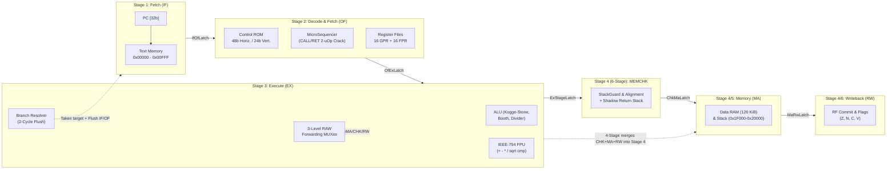

# Monolith — RISC201 Pipelined Microprogrammed Processor

> A cycle-accurate 32-bit RISC microprocessor, assembler/disassembler toolchain, hardware memory-safety unit, and interactive TUI/HTML hardware visualizer built in C++17 for **CSC-201: Computer Organization & Architecture**.

- **Zero-Setup Schematic:** Open [`docs/datapath_schematic.html`](docs/datapath_schematic.html) in any browser to inspect every MUX, bus width, register bank, pipeline latch, 4-stage vs. 6-stage datapath toggle, and 48-bit Horizontal vs. 24-bit Vertical control word.
- **Runs Everywhere (No MinGW Required on Windows):** Builds cleanly via [`CMakePresets.json`](CMakePresets.json) with **MSVC / Visual Studio** on Windows, **Clang** on macOS, **GCC/Clang** on Linux, or **MinGW-w64**, plus an offline headless mode (`-DRISC201_TUI=OFF`).

---

## Quick Start (Windows / macOS / Linux)

Choose either the **full build** (includes the interactive FTXUI terminal debugger) or the **headless build** (zero external network fetches, includes CLI debugger, assembler, disassembler, and all tests).

### 1. Build & Run

| Platform | Prerequisites | Configure, Build & Test |
| :--- | :--- | :--- |
| **Windows (MSVC / Visual Studio 2022+)** | Visual Studio C++ Desktop workload + CMake 3.21+ | `cmake --preset default` -> `cmake --build --preset default` -> `ctest --preset default` |
| **Windows (MSVC Offline / Headless)** | Same as above (no Git/network needed) | `cmake --preset headless` -> `cmake --build --preset headless` -> `ctest --preset headless` |
| **Windows (Visual Studio IDE)** | Open `Monolith/` folder in VS | Select preset **Default** or **Headless** in the toolbar and click **Build -> Build All** |
| **macOS** | `xcode-select --install` and `brew install cmake git` | `cmake --preset default && cmake --build --preset default --parallel && ctest --preset default` |
| **Linux (Ubuntu/Debian)** | `sudo apt install build-essential cmake git` | `cmake --preset default && cmake --build --preset default --parallel && ctest --preset default` |
| **Windows (MinGW-w64 / MSYS2)** | `mingw32-g++`, `mingw32-make`, `cmake` | `cmake --preset mingw-headless && cmake --build --preset mingw-headless && ctest --preset mingw-headless` |

> [!NOTE]
> **Windows Smart App Control / Defender:** On Windows 11 machines with strict Smart App Control or Defender heuristics enabled, newly compiled unsigned `.exe` test binaries may occasionally be blocked or delayed on first launch. If a local `ctest` binary hits an Application Control prompt, run the **Headless** or **Debug** config from a trusted folder, open the interactive schematic directly in your browser ([`docs/datapath_schematic.html`](docs/datapath_schematic.html)), or inspect the automated cross-platform build checks in [`.github/workflows/ci.yml`](.github/workflows/ci.yml).

### 2. Try the Simulator & Toolchain

**macOS / Linux (`build/default/`):**
```bash
# Assemble a program to word-aligned hex
./build/default/risc201asm tests/programs/fib.asm fib.hex --hex

# Disassemble machine code back to mnemonics
./build/default/risc201dis fib.hex

# Launch the interactive full-screen Terminal UI (press 'o' to load .asm, 'c' to toggle 4/6 stages & ROM)
./build/default/risc201-sim --tui

# Or run the CLI debugger (4-stage/6-stage, horizontal/vertical)
./build/default/risc201-sim --headless --stages 6 --encoding vertical fib.hex
```

**Windows MSVC (`build\default\Release\` or `build\headless\Release\`):**
```powershell
.\build\default\Release\risc201asm.exe tests\programs\fib.asm fib.hex --hex
.\build\default\Release\risc201dis.exe fib.hex
.\build\default\Release\risc201-sim.exe --tui
```

Inside `--tui`, you only need a few keys: **`o`** assembles any `.asm` file live, **`c`** switches pipeline depth (`4-Stage` / `6-Stage`) and control store (`Horizontal 48b` / `Vertical 24b`) on the fly, **`s`** steps one instruction, **`u`** time-travels backward one step, **`r`** runs to completion/breakpoint, and **`?`** shows all controls.

---

## Architecture at a Glance

**Monolith** is the repository uniting every subsystem behind the **RISC201** 32-bit ISA (`34` instructions across `8` formats `F1–F8`):



### Core Hardware Specifications
- **Word & Instruction Encoding:** 32-bit fixed instruction words (`4`-byte aligned), configurable compile-time data width (`RISC201_WORD_BITS=32`, optional `64`).
- **Registers:** `16` GPRs (`r0` hardwired `0`, `r1–r12` general purpose, `r13` macro scratch, `r14`/`sp` descending stack pointer, `r15`/`ra` link register), `16` single-precision IEEE-754 FPRs (`f0–f15`), and `Z/N/C/V` condition flags.
- **Physical Memory Map (`128 KiB`, 32,768 words):**
  - `0x00000–0x00FFF` (`4 KiB`): Text / Instruction space (read/fetch only; CPU data writes trap).
  - `0x01000–0x1EFFF` (`120 KiB`): Static / Heap data space.
  - `0x1F000–0x20000` (`4 KiB`): Full-Descending Protected Stack (`sp` initializes to `0x20000`).

---

## How Everything Fits Together (Demystifying Ambiguities)

First-time readers often run into seven architectural questions when exploring the code. Here is exactly how the implementation resolves each one:

1. **Why do both [`PipelineProcessor`](control_unit/pipeline_processor.h) and [`legacy/`](legacy/) exist? Which engine actually runs?**
   - Everything active (`Cpu`, CLI `--headless`, `--tui`, and `risc201-tests` benchmarks) runs **`PipelineProcessor`**. Early in development, `legacy/datapath/` implemented an unpipelined textbook single-bus datapath (`Sarangi Fig. 9.22`, ~10 cycles per instruction) paired with an object-oriented `legacy/assembler/`. Those modules remain preserved in `legacy/` solely so evaluators and tests can reproduce genuine baseline comparisons (**4.79x to 7.31x** speedup) against the single-bus implementation.
2. **How do 4-Stage and 6-Stage configurations differ structurally, and why is 4-Stage faster in cycle counts?**
   - **6-Stage (`IF -> OF -> EX -> MEMCHK -> MA -> RW`):** Runs memory safety checks (`StackGuard` + alignment + `ShadowReturnStack`) in a dedicated Stage 4 (`MEMCHK`) via `ChkMaLatch`, before memory access (`MA`) and writeback (`RW`). Because load values aren't ready for forwarding until later, load-use dependencies stall up to 2 cycles (`CPI 1.42–2.17`).
   - **4-Stage (`IF -> OF -> EX -> MA/RW`):** Merges `MEMCHK` inline into Stage 4 alongside `MA` and `RW` (`ChkMaLatch` is bypassed and `MaRwLatch` acts only as an observation snapshot). That cuts load-use stalls to 1 cycle (`CPI 1.35–1.97`), lowering total cycles on all benchmarks—while trading off higher combinational delay inside Stage 4 (whereas 6-Stage targets higher max clock frequency in physical hardware).
3. **Why do 48-bit Horizontal and 24-bit Vertical Control ROMs take the exact same clock cycles?**
   - In Stage 2 (`OF`), [`ControlUnit::decode_compact()`](control_unit/control_unit.cpp) expands a compressed 24-bit `VerticalControlWord` into the exact same 48-bit `HorizontalControlWord` combinationally on the **same clock edge**. Vertical encoding cuts Control ROM width in half (24b vs 48b) with zero extra pipeline cycles.
4. **How do multi-cycle instructions (`CALL`, `RET`) execute without corrupting pipeline flow?**
   - [`MicroSequencer`](control_unit/micro_sequencer.h) performs Stage-2 **micro-op cracking**. When `CALL` or `RET` enters `OF`, control signals assert `is_multi_uop=1` and `freeze_if_of=1`, holding `PC` and `IfOfLatch` for one extra cycle while injecting `uOp #0` (adjust/check `SP` bounds) followed by `uOp #1` (`is_last_uop=1, freeze_if_of=0`: write/read return PC, update `RA`/redirect `PC`, and push/verify the hardware shadow return stack).
5. **How does `risc201asm` work if `.asm` files don't use `.text` or `.data` directives?**
   - [`risc201asm`](assembler_disassembler/asm.cpp) is a **flat two-pass assembler** starting at byte address `0x00000`. It resolves symbolic labels, expands `LI` and stack macros (`PUSH`, `POP`, `SPUSH`, `SPOP`, `FPUSH`, `FPOP`, `SFPUSH`, `SFPOP` around `r14`), and emits 32-bit hex/binary words. Programs access data space directly via addresses (e.g. `0x10000`), or the debugger `load <text.hex> [data.hex]` command loads an optional second hex image at `0x10000`.
6. **How do hardware memory safety (`StackGuard` + Shadow Stack) catch bugs before memory corrupts?**
   - Every stack push/pop and memory access checks word alignment (`addr % 4 == 0`), rejects data writes into Text space (`< 0x01000`), blocks stores below `sp`, and verifies stack frame limits (`0x1F000–0x20000`) *before* `MemoryUnit::write_word` commits. On `CALL`/`RET`, a hardware `shadow_return_stack_` cross-checks popped return addresses against recorded call sites to catch stack smashing immediately.
7. **How does reverse debugging (`u`) undo writes, flags, and pipeline state?**
   - [`Debugger`](simulator_core/core/debugger.h) keeps a bounded ring history (`4,096` cycles) of snapshots/deltas covering registers (`r0–r15`, `f0–f15`), condition flags, pipeline latches, modified memory words, and the shadow return stack—so `u` restores exact pre-step hardware state cleanly.

---

## Verified Benchmark & Test Results

### Pipeline vs. Single-Bus Baseline ([`tests/test_pipeline.cpp`](tests/test_pipeline.cpp) & [`tests/test_cu_programs.cpp`](tests/test_cu_programs.cpp))

| Benchmark | Configuration | Clock Cycles | Retired Inst. | CPI | Hazards / Stalls | Speedup vs. Single-Bus |
| :--- | :--- | :---: | :---: | :---: | :---: | :---: |
| **Recursive Fibonacci (`N=10`)** | 4-Stage (Horiz. 48b / Vert. 24b) | 3,597 | 1,825 | 1.97 | 1,415 | **5.07x** (vs. 18,230) |
| | 6-Stage (Horiz. 48b / Vert. 24b) | 3,952 | 1,825 | 2.17 | 1,768 | **4.79x** (vs. 18,937) |
| **Matrix Multiply + FPU (`2x2`)** | 4-Stage (Horiz. 48b / Vert. 24b) | 315 | 229 | 1.38 | 83 | **7.31x** (vs. 2,303) |
| | 6-Stage (Horiz. 48b / Vert. 24b) | 326 | 229 | 1.42 | 92 | **7.15x** (vs. 2,331) |
| **Bubble Sort + Checksum** | 4-Stage (Horiz. 48b / Vert. 24b) | 818 | 606 | 1.35 | 209 | **7.09x** (vs. 5,800) |
| | 6-Stage (Horiz. 48b / Vert. 24b) | 869 | 606 | 1.43 | 258 | **6.81x** (vs. 5,918) |

### Automated Verification Summary
- **`22` CTest Targets ([`CMakeLists.txt`](CMakeLists.txt)):** `risc201-tests`, `stack-guard-test`, `memory-unit-test`, `stack-visualizer-test`, plus `18` assemble/disassemble round-trip integration checks across `fib`, `fac`, `matmul`, `sort`, `all_34_opcodes`, `alu_ops`, `control_flow`, `fpu_ops`, and `memory_ops`.
- **`62` Unit Tests + `80/80` Hardware Safety Matrix (`risc201-tests`):** Covers ALU edge cases, IEEE-754 FPU, `r0` hardwired-zero protection, 3-level RAW forwarding, load-use interlocks, branch flushes, multi-µop `CALL`/`RET`, reverse time-travel debugging, and all 80 safety permutations (`4/6` stage × `Horizontal/Vertical` × `20` fault/safety scenarios).

---

## Repository Map & Documentation

```text
Monolith/
├── control_unit/           # PipelineProcessor (4/6 stages), Control ROMs (48b/24b), MicroSequencer
├── simulator_core/         # Cpu engine, reversible Debugger, CLI & interactive FTXUI TUI
├── memory/                 # MemoryUnit (128 KiB byte-addressed, 4B aligned, write-journaled)
├── alu/ & fpu/             # Kogge-Stone Adder, Radix-4 Booth Multiplier, Non-Restoring Divider, IEEE-754 FPU
├── memory_safety/          # StackGuard bounds firewall, ExceptionCode, ASCII StackVisualizer
├── assembler_disassembler/ # Two-pass CLI assembler (risc201asm) & disassembler (risc201dis)
├── isa_spec/               # Canonical 34-opcode RISC201 ISA specification & instruction formats
├── legacy/                 # Archived single-bus datapath baseline & legacy modular assembler
├── tests/                  # Unit suites, safety matrix, benchmarks, and 9 .asm test programs
├── docs/                   # Interactive HTML schematic & subsystem engineering docs
└── .github/workflows/      # Cross-platform CI (Linux, macOS, Windows MSVC & MinGW)
```

| Documentation File | What You Will Learn |
| :--- | :--- |
| **[`docs/datapath_schematic.html`](docs/datapath_schematic.html)** | Interactive hardware schematic (open in browser; inspect wires, latches, control words, memory map) |
| **[`docs/architecture.md`](docs/architecture.md)** | Hardware architecture, 48b Horizontal vs. 24b Vertical ROM bitfields, ALU/FPU design |
| **[`docs/pipeline.md`](docs/pipeline.md)** | Stage-by-stage timing, latch struct fields, RAW forwarding priority, stall & flush logic |
| **[`docs/isa.md`](docs/isa.md)** | Full 34-opcode table, `F1–F8` instruction encodings, flags, and stack macro expansion |
| **[`docs/memory_safety.md`](docs/memory_safety.md)** | 128 KiB memory map, `StackGuard` firewall checks, shadow stack, and fault codes |
| **[`docs/tui.md`](docs/tui.md)** | Interactive FTXUI hotkey reference (`o`/`c`/`s`/`u`/`r`/`b`) and CLI command guide |
| **[`docs/plan.md`](docs/plan.md)** | Evolutionary engineering log, requirement compliance matrix, and test inventory |
