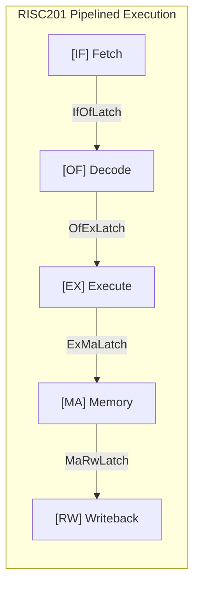

# RISC201 Processor Hardware Specification

**Course:** CSC-201 Computer Organization & Architecture  
**Architecture:** 32-bit Load-Store RISC with Microprogrammed Control Store  
**Pipelines:** 4-Stage and 6-Stage Synchronous Datapaths  

---

## 1. System Overview

The RISC201 is a cycle-accurate 32-bit microprocessor. It implements a load-store architecture where arithmetic and logical operations operate strictly on registers, while memory is accessed exclusively through dedicated load (`LD`, `FLD`) and store (`ST`, `FST`) instructions.

### Architectural State
- **General-Purpose Registers (GPRs):** 16 registers (`r0`–`r15`), 32 bits wide.
  - `r0`: Hardwired to constant zero. Writes to `r0` are discarded.
  - `r1`–`r12`: General-purpose operand and scratch registers.
  - `r13`: Swap temporary register used in macro expansions.
  - `r14` (`sp`): Hardware stack pointer for full-descending stack.
  - `r15` (`ra`): Subroutine return address register.
- **Floating-Point Registers (FPRs):** 16 registers (`f0`–`f15`), 32 bits wide, storing IEEE-754 single-precision floating-point values.
- **Program Counter (PC):** 32-bit register pointing to the current instruction address. Instructions are 32 bits wide and aligned on 4-byte boundaries.
- **Condition Flags:** `Z` (Zero), `N` (Negative), `C` (Carry), `V` (Overflow).

---

## 2. Datapath Evolution: Single-Bus vs. Pipelined

### Single-Bus Baseline Architecture (Sarangi Figure 9.22)
In the classic microprogrammed architecture, all internal registers (`PC`, `IR`, `MAR`, `MDR`, `A`, `B`, `aluResult`, register file) share a single internal data bus. Every data transfer must occur serially, requiring multiple clock cycles per macro-instruction:
- **Instruction Fetch (4 cycles):** `PC -> MAR`, `MemRead`, `MDR -> Bus -> IR`, `PC = PC + 4`.
- **Operand Fetch (2 cycles):** `IR -> RegFile -> A`, `IR -> RegFile -> B`.
- **ALU Execution (1 cycle):** `A, B -> ALU -> aluResult`.
- **Memory Access (2 cycles):** `aluResult -> MAR`, `Bus -> MDR -> DataMem`.
- **Writeback (1 cycle):** `MDR / aluResult -> Bus -> RegFile`.

Because the bus serializes all transfers, the baseline processor averages a high CPI of 9.8 to 10.4.

### Pipelined Architecture
The RISC201 replaces the shared bus bottleneck with dedicated, synchronous inter-stage pipeline registers (`IfOfLatch`, `OfExLatch`, `ExMaRwLatch`, etc.), allowing overlapping execution where an instruction begins each clock cycle.



---

## 3. Pipeline Configurations

The processor supports two distinct pipeline configurations in `control_unit/pipeline_processor.cpp`:

### A. 4-Stage Pipeline (`[IF] -> [OF] -> [EX] -> [MA/RW]`)
Designed for low instruction latency and compact datapath area:
1. **Fetch (`IF`):** Fetches 32-bit instruction from memory at `PC`; computes `PC + 4`.
2. **Decode & Operand Fetch (`OF`):** Decodes instruction format; accesses Control ROM; reads source registers (`rs1`, `rs2`); generates immediates; evaluates load-use hazard interlocks.
3. **Execute (`EX`):** ALU/FPU execution; effective address calculation; branch condition evaluation; RAW data forwarding.
4. **Memory Access & Writeback (`MA/RW`):** Combined stage that performs data memory access (`LD`/`ST`), enforces memory safety bounds, and writes back result to destination register `rd`.

- **Branch Penalty:** 2 cycles (resolved in `EX`; flushes `IF` and `OF`).
- **Load-Use Penalty:** 1 stall cycle.

### B. 6-Stage Pipeline (`[IF] -> [OF] -> [EX] -> [MEMCHK] -> [MA] -> [RW]`)
Designed for higher clock frequencies and isolated hardware memory safety:
1. **Fetch (`IF`):** Reads instruction at `PC`; increments `PC + 4`.
2. **Decode (`OF`):** Decodes instruction and retrieves operands from register file.
3. **Execute (`EX`):** ALU and FPU arithmetic; branch target evaluation.
4. **Memory Check (`MEMCHK`):** Dedicated hardware stage validating effective memory address, stack limits, and word alignment before bus strobes fire.
5. **Memory Access (`MA`):** Executes verified memory read or write.
6. **Register Writeback (`RW`):** Commits result to destination register.

- **Branch Penalty:** 2 cycles.
- **Load-Use Penalty:** 2 stall cycles.

---

## 4. Editable Architecture Diagram (Draw.io)

The complete vector block diagram for the 4-stage and 6-stage datapaths is available in:
- **File:** [`docs/diagrams/pipeline_datapath.drawio`](./diagrams/pipeline_datapath.drawio)
- **How to edit:** Open this file directly in VS Code (using the *Draw.io Integration* extension) or via [app.diagrams.net](https://app.diagrams.net). You can drag boxes, adjust signal names, and export cleanly to PNG or SVG without broken fonts or clipped text.

---

## 5. Microprogrammed Control Unit

Rather than complex hardwired decoding logic, control signals are stored in Control Memory ROM tables. The Control Unit supports two encoding schemes that achieve identical execution cycles and retirement parity.

### A. 48-bit Horizontal Control ROM
Directly sets all control lines with zero combinational decoding delay:
- Uncompressed bitfields route directly to ALU operand muxes, memory strobes, branch logic, and writeback targets.
- 128 words deep, 48 bits wide.

### B. 24-bit Vertical Control ROM
Compresses control information into packed functional fields:
- `op_class` (3 bits): ALU, FPU, Memory, Branch, System, Flow.
- `sub_op` (4 bits): Operation code within the selected class.
- `operand_mode` (3 bits): Source operand selection.
- `mem_action` (2 bits): None, Read, Write, CheckOnly.
- `wb_target` (3 bits): None, ALU, Memory, PC+4, FPU.
- A small combinational micro-decoder circuit unpacks the 24-bit word into the full pipeline control signals with negligible logic delay (~1 ns).
- **Result:** Cuts control store ROM storage area by **50%** while maintaining 100% cycle parity with the horizontal model.

### C. Micro-Sequencer & Multi-Cycle Operations
While standard instructions (`ADD`, `SUB`, `LD`, `ST`, branches) execute as single-cycle operations, complex instructions (`CALL`, `RET`, `BNDCHK`) require multi-step sequences:
1. When a multi-step instruction is decoded in `OF`, the `MicroSequencer` asserts `freeze_if_of = true`.
2. The `PC` and `IF/OF` pipeline registers hold their values while the sequencer injects atomic micro-operations into `OF/EX`:
   - **`CALL` step 0:** Bounds check and decrement stack pointer (`sp = sp - 4`).
   - **`CALL` step 1:** Store return address to memory (`Mem[sp] = PC + 4`), set `PC = target`.
   - **`RET` step 0:** Read return address from stack (`ra = Mem[sp]`).
   - **`RET` step 1:** Increment stack pointer (`sp = sp + 4`), update `PC = ra`.
3. When `is_last_uop = true`, `freeze_if_of` is deasserted and normal pipeline flow resumes.

---

## 6. Control Word Bitfields

### 48-bit Horizontal Word Layout
```
Bit Range | Field Name     | Function / Encoding
----------|----------------|----------------------------------------------------
[3:0]     | alu_op         | NOP=0, ADD=1, SUB=2, MUL=3, DIV=4, MOD=5, AND=6,
          |                | OR=7, NOT=8, XOR=9, LSL=10, LSR=11, ASR=12, CMP=13
[5:4]     | op_a_src       | 0=RS1, 1=IMM, 2=PC, 3=ZERO
[7:6]     | op_b_src       | 0=RS2, 1=IMM, 2=ZERO
[8]       | set_flags      | 1 = update condition flags (Z, N, C, V)
[11:9]    | branch_cond    | 0=EQ, 1=NE, 2=GT, 3=LT
[12]      | is_branch      | 1 = branch instruction
[13]      | is_call        | 1 = subroutine call
[14]      | is_ret         | 1 = subroutine return
[15]      | is_fpu         | 1 = route to FPU domain
[18:16]   | fpu_op         | FADD=1, FSUB=2, FMUL=3, FDIV=4, FCMP=5, FMOV=6
[19]      | chk_enable     | 1 = activate StackGuard memory check
[21:20]   | chk_mode       | 0=STACK_BOUNDS, 1=MEMORY_ADDR, 2=BNDCHK
[22]      | mem_read       | 1 = assert data memory read strobe
[23]      | mem_write      | 1 = assert data memory write strobe
[24]      | ma_is_fpu      | 1 = floating-point memory transaction
[25]      | reg_write_en   | 1 = write result back to register file
[28:26]   | reg_write_src  | 0=ALU_OUT, 1=MEM_DATA, 2=PC_PLUS4, 3=FPU_OUT
[29]      | wb_is_fpu      | 1 = write back to FPR (f0..f15), 0 = GPR (r0..r15)
[30]      | freeze_if_of   | 1 = freeze IF/OF latch (stall front-end)
[31]      | is_multi_uop   | 1 = microcode sequence active
[32]      | is_last_uop    | 1 = final micro-operation of instruction
[33]      | halt           | 1 = halt processor clock
[47:34]   | next_micro_pc  | Micro-sequencer target address
```

### 24-bit Vertical Word Layout
```
Bit Range | Field Name     | Function / Encoding
----------|----------------|----------------------------------------------------
[2:0]     | op_class       | 0=ALU, 1=FPU, 2=MEM, 3=BRANCH, 4=SYSTEM, 5=FLOW
[6:3]     | sub_op         | Operation code within selected class
[9:7]     | operand_mode   | Joint source multiplexer configuration
[11:10]   | mem_action     | 0=None, 1=Read, 2=Write, 3=CheckOnly
[14:12]   | wb_target      | 0=None, 1=ALU, 2=MEM, 3=PC+4, 4=FPU
[15]      | is_fpu_domain  | 0=Integer GPR, 1=Floating-Point FPR
[16]      | set_flags      | 1 = update condition flags
[17]      | freeze_if_of   | 1 = freeze front-end fetch/decode latches
[18]      | is_multi_uop   | 1 = multi-uop sequence active
[19]      | is_last_uop    | 1 = final micro-operation
[20]      | halt           | 1 = halt processor clock
[23:21]   | next_uop_step  | Micro-step index (0-7)
```

---

## 7. Hardware Subsystems

### Integer ALU (`alu/ALU.cpp`)
- **Arithmetic:** 32-bit Kogge-Stone parallel prefix adder (`ADD`, `SUB`), Radix-4 Booth multiplier (`MUL`), non-restoring divider (`DIV`, `MOD`).
- **Logic:** Bitwise `AND`, `OR`, `XOR`, `NOT`.
- **Shifts:** Logical shift left (`LSL`), logical shift right (`LSR`), arithmetic shift right (`ASR`).
- **Flags:** Updates `Z` (result == 0), `N` (result < 0), `C` (unsigned carry/borrow), and `V` (signed overflow).

### Floating-Point Unit (`fpu/fpu.cpp`)
- **Format:** IEEE-754 single-precision (1 sign bit, 8 exponent bits with bias 127, 23 mantissa bits with implicit leading 1).
- **Operations:** `FADD`, `FSUB` (mantissa alignment, addition/subtraction, normalization), `FMUL` (64-bit Booth mantissa multiplier), `FDIV` (non-restoring divider), `FCMP` (float compare setting condition flags), `FMOV` (float register transfer).

### Memory Safety Subsystem (`memory_safety/stack_guard.cpp`)
- **Stack Window:** `0x1F000` (limit) to `0x20000` (initial top, exclusive). Full-descending stack on `r14` (`sp`).
- **Protection:** Prevents writes below active `sp`, detects stack overflow/underflow, and validates 4-byte alignment (`addr % 4 == 0`).
- **Exceptions:** Triggers runtime exceptions before illegal bus transactions can commit to data memory.
