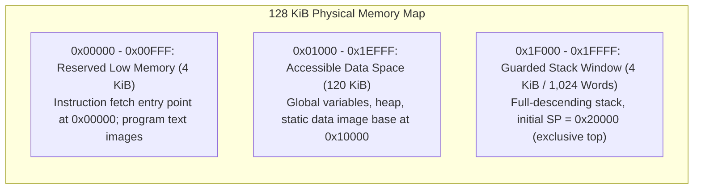
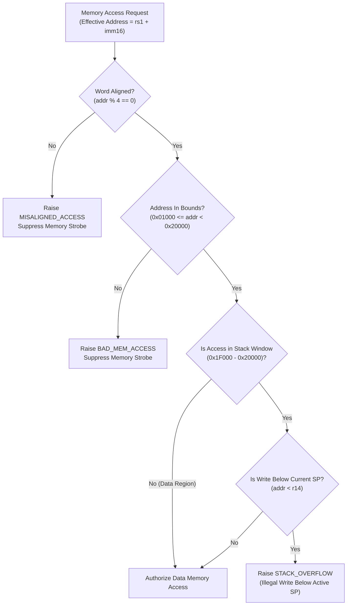
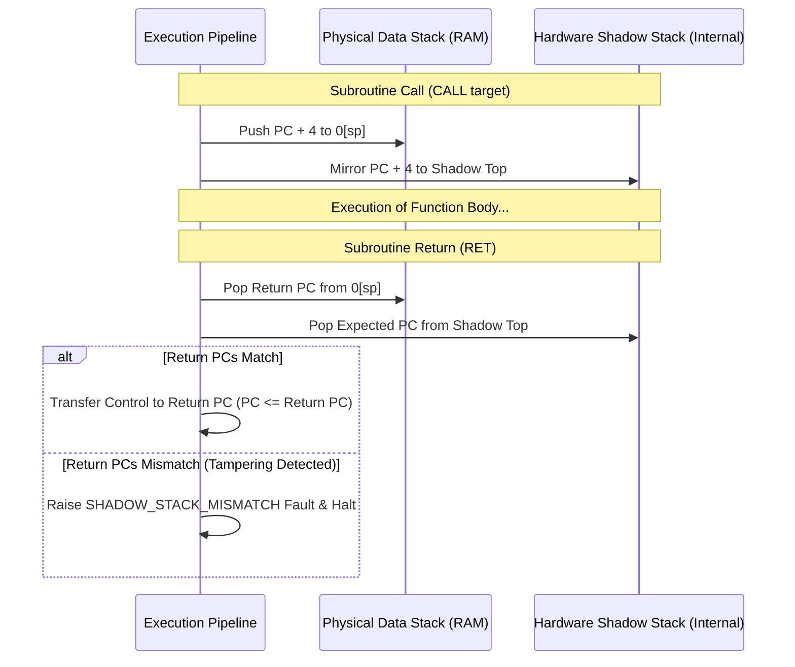

# RISC201 Memory Safety Subsystem & StackGuard Specification

**Course:** CSC-201 Computer Organization & Architecture  
**Subsystem:** Hardware Memory Protection, Stack Firewall & Shadow Return Stack  
**Source Implementation:** [`memory_safety/stack_guard.h`](file:///e:/CSC-201/Monolith/memory_safety/stack_guard.h), [`memory_safety/stack_guard.cpp`](file:///e:/CSC-201/Monolith/memory_safety/stack_guard.cpp), [`memory/memory_unit.h`](file:///e:/CSC-201/Monolith/memory/memory_unit.h), [`simulator_core/core/exception.h`](file:///e:/CSC-201/Monolith/simulator_core/core/exception.h)  

---

## 1. Physical Memory Map & Segmentation

The RISC201 processor addresses a 128 KiB (131,072 bytes) physical address space organized as 32,768 32-bit words. Memory is byte-addressed, but all physical memory accesses must be aligned to 4-byte word boundaries:



### Segmentation Rules
1. **Reserved Low Memory / Program Text (`0x00000` to `0x00FFF`):**  
   Contains loaded program machine code and entry point. The instruction fetch (`IF`) stage fetches instructions starting at `0x00000`. Low memory below `0x01000` is reserved for instructions and protected from runtime data writes.
2. **Accessible Data Region (`0x01000` to `0x1EFFF`):**  
   General accessible data segment (120 KiB). Read-write access is permitted for general load and store instructions (`LD`, `ST`, `FLD`, `FST`). By convention, assembler and CLI programs load static data structures starting at `kDataBase = 0x10000`.
3. **Guarded Stack Window (`0x1F000` to `0x20000`):**  
   Dedicated hardware stack region (4 KiB / 1,024 words). The stack grows downwards (full-descending) from the exclusive upper boundary `0x20000`. The first push writes to `0x1FFFC`. The lowest legal stack address is `0x1F000`.

---

## 2. Hardware Memory Safety Protections



### 1. Strict Word Alignment Enforcement
All memory load and store instructions (`LD`, `ST`, `FLD`, `FST`) and stack preflight checks (`BNDCHK`) require physical addresses to be word-aligned:
$$\text{addr} \pmod 4 == 0$$
Any access with $\text{addr} \pmod 4 \neq 0$ immediately aborts before memory strobes fire, raising a `MISALIGNED_ACCESS` exception.

### 2. Stack Boundary Protection (`StackGuard`)
The [`StackGuard`](file:///e:/CSC-201/Monolith/memory_safety/stack_guard.h) hardware unit monitors `r14` (`sp`) and all memory addresses accessing the stack:
- **Stack Overflow Detection:** If a push operation or stack pointer decrement moves `sp` below the floor `0x1F000`, execution halts immediately with a `STACK_OVERFLOW` exception.
- **Stack Underflow Detection:** If a pop operation or stack pointer increment moves `sp` above the initial top `0x20000`, execution halts with a `STACK_UNDERFLOW` exception.
- **Write-Below-SP Prevention:** Any memory write targeting an address in the stack range that is below the active stack pointer (`addr < sp`) is blocked with a `STACK_OVERFLOW` exception. This prevents "red-zone" stack corruption and dangling pointer clobbering.

### 3. Dedicated `MEMCHK` Stage (6-Stage Pipeline)
In the 6-stage pipeline, memory safety verification is decoupled into a dedicated hardware stage (`MEMCHK`, Stage 4) positioned between Execute (`EX`) and Memory Access (`MA`):
- `EX` computes the effective address (`rs1 + imm16`).
- `MEMCHK` evaluates alignment, segment bounds, and `StackGuard` rules.
- If a fault is detected, the instruction is neutralized before entering `MA`, ensuring that illegal memory write strobes never reach the physical data memory arrays.

---

## 3. Shadow Return Stack Protection

To protect subroutine call returns against return-oriented programming (ROP) and buffer overflow exploits that overwrite stack return addresses, the processor incorporates a protected, hardware-isolated **Shadow Return Stack**:



### Operation
1. **On `CALL`:**  
   The return address ($PC + 4$) is pushed onto the standard architectural stack at `Mem[sp - 4]` and simultaneously mirrored onto the hardware shadow return stack.
2. **On `RET`:**  
   The processor pops the return address from the architectural stack and compares it against the top of the shadow return stack.
   - If the addresses match, control is transferred to the return address and `sp` increments by 4.
   - If the addresses differ (e.g., due to an arbitrary memory overwrite or stack smash), the CPU halts immediately with a `SHADOW_STACK_MISMATCH` fault, recording the offending address.
3. **Debugger Checkpoint Integration:**  
   The shadow stack state is saved in `Cpu` snapshots, allowing reverse execution (`u` command in TUI) to restore shadow return frames accurately.

---

## 4. Runtime Exception Framework

When a memory safety or microarchitectural violation occurs, the datapath asserts an exception signal and commits a non-recoverable fault state:

| Exception Code | Value | Triggering Condition | Architectural Response |
| :--- | :---: | :--- | :--- |
| **`NONE`** | `0` | Normal execution | Pipeline continues |
| **`DIV_BY_ZERO`** | `1` | Integer `DIV` or `MOD` with divisor $= 0$ | ALU flags set; CPU halts |
| **`BAD_MEM_ACCESS`** | `2` | Access outside valid data/stack bounds or below `0x01000` | Memory strobe aborted; CPU halts with fault address |
| **`MISALIGNED_ACCESS`** | `3` | Memory access with $\text{addr} \pmod 4 \neq 0$ | Bus transaction aborted; CPU halts with fault address |
| **`STACK_OVERFLOW`** | `4` | Stack pointer decremented below `0x1F000` or write below active `sp` | Write suppressed; CPU halts with fault address |
| **`STACK_UNDERFLOW`** | `5` | Stack pointer incremented above `0x20000` | Pop suppressed; CPU halts with fault address |
| **`SHADOW_STACK_MISMATCH`** | `6` | `RET` return PC differs from shadow stack | Control transfer aborted; CPU halts |
| **`ILLEGAL_INSTRUCTION`** | `7` | Instruction opcode $> 0x37$ or undefined | Pipeline halts; uncommitted latches flushed |

---

## 5. Verification Matrix: 80/80 Permutation Coverage

The memory safety architecture is verified through an automated 80-case regression matrix executed in [`tests/test_cpu.cpp`](file:///e:/CSC-201/Monolith/tests/test_cpu.cpp):
- **20 Test Scenarios** evaluated across **4 Datapath Configurations** (4-Stage Horizontal, 4-Stage Vertical, 6-Stage Horizontal, 6-Stage Vertical):
  1. `CALL`/`RET` round-trip execution.
  2. `CALL` stack overflow detection (preflight check before SP modification).
  3. `RET` on empty stack (underflow detection).
  4. Valid data segment load and store round-trip.
  5. Illegal store below current `sp` rejection.
  6. Misaligned stack load rejection.
  7. Integer `LD` out-of-bounds rejection.
  8. Integer `LD` misaligned address rejection.
  9. Integer `ST` out-of-bounds rejection.
  10. Integer `ST` misaligned address rejection.
  11. Floating-point `FLD` out-of-bounds rejection.
  12. Floating-point `FLD` misaligned address rejection.
  13. Floating-point `FST` out-of-bounds rejection.
  14. Floating-point `FST` misaligned address rejection.
  15. Corrupted return address on stack (`SHADOW_STACK_MISMATCH`).
  16. Nested `CALL`/`RET` sequences.
  17. Unmatched `RET` without preceding `CALL`.
  18. `BNDCHK` on valid address.
  19. `BNDCHK` on out-of-range address.
  20. `BNDCHK` on misaligned address.
- **Result:** **80/80 cases passing (100%)**.

---

## 6. Interactive ASCII Stack Visualizer

The simulator includes an interactive ASCII stack visualizer accessible via the line-based CLI (`stack [N]` or `stackviz [N]`) and the FTXUI TUI:

```text
======================================================
  RISC201 ACTIVE STACK FRAME VISUALIZER (SP = 0x1FFF4)
======================================================
  [LIMIT] 0x1F000 | ----------------------------------
                  | ... [1020 free stack words] ...
  [FRAME] 0x1FFF0 | 0x0000002A  (Param / Local var: 42)
  [FRAME] 0x1FFF4 | 0x00000040  (Local var: 64)   <-- [ACTIVE SP]
  [RET]   0x1FFF8 | 0x00000014  (Saved Return PC: 0x14) [CALL FRAME]
  [FRAME] 0x1FFFC | 0x0000000A  (Arg 0: 10)
  [BASE]  0x20000 | ================================== (Initial Top)
======================================================
```

- **Live Tracking:** Renders memory words, active `SP`, and frame boundaries.
- **Trace Mode:** `stack trace [steps] [window]` traces stack mutations instruction-by-instruction, printing memory word diffs and SP movements labeled as pushes or pops.
