# RISC201 Pipeline & Hazard Resolution Specification

This document details the pipeline register latches, data forwarding logic, load-use hazard interlocks, and branch resolution mechanics for the 4-stage and 6-stage datapaths in `control_unit/pipeline_processor.cpp`.

---

## 1. Pipeline Stages Comparison

| Feature | 4-Stage Datapath | 6-Stage Datapath |
| :--- | :--- | :--- |
| **Stage Breakdown** | `[IF] -> [OF] -> [EX] -> [MA/RW]` | `[IF] -> [OF] -> [EX] -> [MEMCHK] -> [MA] -> [RW]` |
| **Memory Access** | Combined with writeback in `MA/RW` | Dedicated `MA` stage |
| **Memory Safety Check** | Inline verification inside `MA/RW` | Dedicated `MEMCHK` pipeline stage |
| **Branch Penalty** | 2 cycles (resolved in `EX`) | 2 cycles (resolved in `EX`) |
| **Load-Use Penalty** | 1 stall cycle | 2 stall cycles |
| **Forwarding Sources** | `EX/MA_RW` | `EX/CHK`, `CHK/MA`, and `MA/RW` |
| **Critical Path** | $\max(T_{\text{IF}}, T_{\text{OF}}, T_{\text{EX}}, T_{\text{MA}} + T_{\text{RW}})$ | $\max(T_{\text{IF}}, T_{\text{OF}}, T_{\text{EX}}, T_{\text{CHK}}, T_{\text{MA}}, T_{\text{RW}})$ |

---

## 2. Synchronous Inter-Stage Latches

Data and control signals are propagated through the pipeline using synchronous register bundles defined in `control_unit/pipeline_bundles.h`:

```
4-Stage Latches:   [PC] ──► [IF/OF] ──► [OF/EX] ──► [EX/MA_RW] ──► (Commit to RegFile)
6-Stage Latches:   [PC] ──► [IF/OF] ──► [OF/EX] ──► [EX/CHK] ──► [CHK/MA] ──► [MA/RW]
```

### Latch Contents

1. **`IfOfLatch` (between IF and OF):**
   - `pc`: 32-bit address of the fetched instruction.
   - `raw`: 32-bit instruction word from instruction memory cache.
   - `valid`: Valid bit indicating whether the latch contains an active instruction or a bubble.

2. **`OfExLatch` (between OF and EX):**
   - `pc`: Instruction address.
   - `op_a`, `op_b`: Source operand values read from GPR/FPR register files or forwarded.
   - `imm`: Sign-extended, zero-extended, or shifted immediate value.
   - `dest_reg`: Destination register index (`rd`, 0–15).
   - `control`: Control bundle containing stage-specific sub-bundles:
     - `ExControl`: `alu_op`, `fpu_op`, `operand_a_src`, `operand_b_src`, `set_flags`, `branch_cond`, `is_branch`, `is_call`, `is_ret`, `is_fpu`.
     - `ChkControl`: `memchk_enable`, `chk_mode`.
     - `MaControl`: `mem_read`, `mem_write`, `is_fpu`.
     - `WbControl`: `reg_write_en`, `reg_write_src`, `is_fpu`.

3. **`ExStageLatch` / `ExMaRwLatch` (between EX and MA/RW):**
   - `alu_result`: Output from integer ALU, IEEE-754 FPU, or effective memory address (`base + offset`).
   - `store_val`: Data word to be written to memory on store instructions.
   - `dest_reg`: Destination register index.
   - Propagated `ChkControl`, `MaControl`, and `WbControl` sub-bundles.

4. **`ChkMaLatch` (between MEMCHK and MA in 6-stage):**
   - Verified address, store data, and writeback signals after passing `StackGuard` checks.

5. **`MaRwLatch` (between MA and RW in 6-stage):**
   - `wb_data`: Data word loaded from memory or passed from ALU/FPU.
   - `dest_reg`: Target register to be updated during writeback.

---

## 3. Hazard Resolution Mechanics

```mermaid
graph TD
    subgraph ForwardingLoop [" RAW Forwarding Paths (0 Cycles Delay) "]
        EX["Stage 3: EX<br/>ALU / FPU"]
        MEM["Stage 4/5: MA / RW<br/>Memory / Commit"]
        MEM -.->|"Forward to OpA"| EX
        MEM -.->|"Forward to OpB"| EX
    end

    subgraph HazardStall [" Load-Use Hazard Interlock "]
        LOAD["Load in OF/EX"] -->|"Detect rs1/rs2 match"| STALL["Hazard Unit<br/>Asserts stall_if_of"]
        STALL -->|"1 Cycle Bubble (4-Stg)<br/>2 Cycle Bubbles (6-Stg)"| BUBBLE["Inject NOP into OF/EX<br/>Hold PC and IF/OF"]
    end

    subgraph BranchFlush [" Control Hazard (Branch Taken) "]
        BR["Branch Evaluated in EX"] -->|"Condition Met"| FLUSH["Flush younger stages<br/>IF/OF <= NOP<br/>OF/EX <= NOP"]
        FLUSH -->|"Target PC"| NEXT_PC["PC <= Branch Target"]
    end
```



### A. Read-After-Write (RAW) Data Hazards & Forwarding
A RAW hazard occurs when an instruction in `EX` needs an operand produced by a prior instruction that has not yet completed writeback to the register file.

- **Forwarding Unit (`control_unit/hazard_unit.h`):**
  - Monitors the destination register (`dest_reg`) and `reg_write_en` flag of downstream stage latches.
  - If `EX/MA_RW.dest_reg == OF/EX.rs1` (and `dest_reg != 0`), operand A is taken directly from `EX/MA_RW.alu_result` rather than the register file.
  - Similarly, if `EX/MA_RW.dest_reg == OF/EX.rs2`, operand B is forwarded.
  - In the 6-stage pipeline, forwarding checks `EX/CHK`, `CHK/MA`, and `MA/RW` in reverse chronological order, forwarding the newest result.
- **Penalty:** **0 stall cycles**. The dependent instruction executes without delay.

### B. Load-Use Data Hazards
When an instruction immediately following a load instruction (`LD`, `FLD`) depends on the loaded memory value, forwarding cannot resolve the hazard because the data has not yet been read from data memory.

- **Detection Condition:**
  ```cpp
  bool is_load = of_ex.control.ma.mem_read;
  bool match_a = (of_ex.dest_reg == if_of.rs1);
  bool match_b = (of_ex.dest_reg == if_of.rs2);
  bool hazard  = is_load && (match_a || match_b) && (of_ex.dest_reg != 0);
  ```
- **Action:**
  - **4-Stage Pipeline:** Injects **1 stall bubble** into `OF/EX`. While the load completes `MA/RW` in the next cycle, the dependent instruction waits in `OF`, and then reads the newly committed register with zero further delay.
  - **6-Stage Pipeline:** Injects **2 stall bubbles** into `OF/EX` because memory read completes in the `MA` stage. When the loaded data is latched into `MA/RW`, it is forwarded directly to `EX` for the dependent instruction via Rule 3 forwarding, avoiding any third stall cycle.
  - While stalled, `PC` and `IF/OF` registers hold their current values.

### C. Control Hazards (Branches & Subroutine Calls)
Branches (`B`, `BEQ`, `BNE`, `BGT`, `BLT`), subroutine calls (`CALL`), and returns (`RET`) evaluate their condition codes in `EX` (Stage 3).

- **Sequential Execution (Branch Not Taken):**
  - Execution continues sequentially with `PC = PC + 4`. Zero penalty cycles.
- **Branch Taken:**
  - `PC` is redirected to the computed target address.
  - The speculative instructions currently in `IF/OF` and `OF/EX` are discarded by asserting synchronous flush signals (`flush_if_of = true`, `flush_of_ex = true`).
  - **Penalty:** **2 cycles**.

### D. Micro-Sequencer Multi-Step Hazards
Complex instructions (`CALL`, `RET`, `BNDCHK`) require 2 micro-operations to perform stack pointer arithmetic and memory transfers:
- The sequencer asserts `freeze_if_of = true`, holding the fetch and decode registers.
- Consecutive micro-ops stream down `OF/EX` until `is_last_uop = true`, ensuring atomic multi-step execution without corrupting architectural state.
