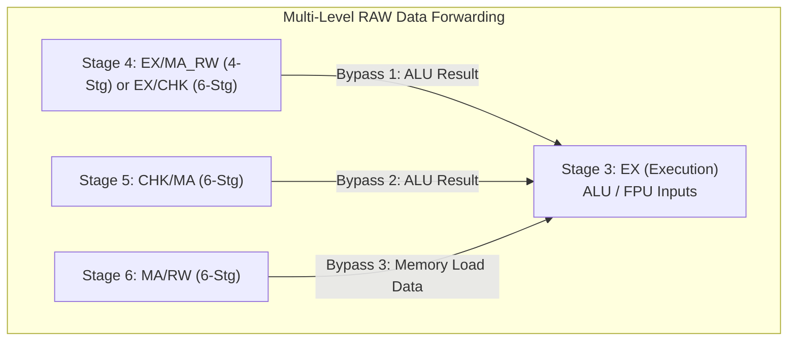
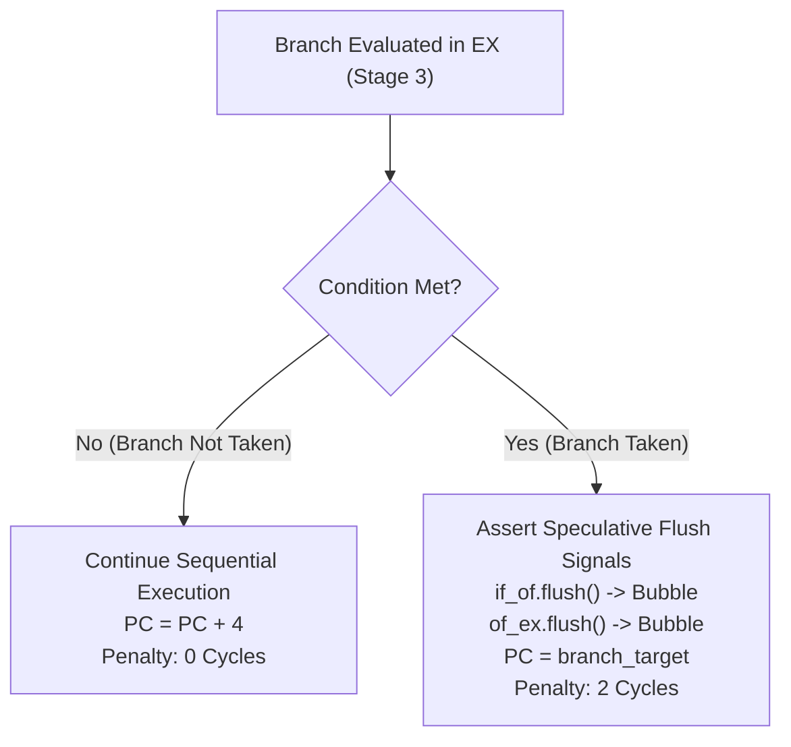

# RISC201 Pipeline & Hazard Resolution Specification

**Course:** CSC-201 Computer Organization & Architecture  
**Module:** Datapath Pipelining, Hazard Detection & Multi-Level Forwarding  
**Source Implementation:** [`control_unit/pipeline_processor.cpp`](file:///e:/CSC-201/Monolith/control_unit/pipeline_processor.cpp), [`control_unit/hazard_unit.h`](file:///e:/CSC-201/Monolith/control_unit/hazard_unit.h), [`control_unit/pipeline_bundles.h`](file:///e:/CSC-201/Monolith/control_unit/pipeline_bundles.h)  

---

## 1. Overview & Pipeline Configurations

The RISC201 replaces the classical serialized single-bus datapath (documented in [`legacy/`](file:///e:/CSC-201/Monolith/legacy)) with a fully synchronous, interlocked pipelined execution engine. The processor supports two distinct pipeline configurations selectable at runtime via the `--stages` flag:

```mermaid
graph TD
    subgraph FourStage [" 4-Stage Pipeline Configuration (--stages 4) "]
        direction LR
        IF4["[IF] Fetch"] -->|"IfOfLatch"| OF4["[OF] Decode"]
        OF4 -->|"OfExLatch"| EX4["[EX] Execute"]
        EX4 -->|"ExStageLatch"| MARW4["[MA/RW] Memory & Commit"]
    end

    subgraph SixStage [" 6-Stage Pipeline Configuration (--stages 6) "]
        direction LR
        IF6["[IF] Fetch"] -->|"IfOfLatch"| OF6["[OF] Decode"]
        OF6 -->|"OfExLatch"| EX6["[EX] Execute"]
        EX6 -->|"ExChkLatch"| CHK6["[MEMCHK] Firewall"]
        CHK6 -->|"ChkMaLatch"| MA6["[MA] Memory"]
        MA6 -->|"MaRwLatch"| RW6["[RW] Writeback"]
    end
```



### Architectural Comparison

| Microarchitectural Parameter | 4-Stage Datapath | 6-Stage Datapath |
| :--- | :--- | :--- |
| **Pipeline Stages** | `[IF] -> [OF] -> [EX] -> [MA/RW]` | `[IF] -> [OF] -> [EX] -> [MEMCHK] -> [MA] -> [RW]` |
| **Memory Access Stage** | Combined with commit in `MA/RW` (Stage 4) | Dedicated `MA` stage (Stage 5) |
| **Memory Safety Check** | Inline verification inside `MA/RW` | Dedicated `MEMCHK` hardware firewall stage (Stage 4) |
| **Branch Penalty** | 2 clock cycles (evaluated in `EX`) | 2 clock cycles (evaluated in `EX`) |
| **Load-Use Penalty** | 1 stall cycle | 2 stall cycles |
| **Forwarding Sources** | `EX/MA_RW` | `EX/CHK`, `CHK/MA`, and `MA/RW` |
| **Critical Timing Path** | $\max(T_{\text{IF}}, T_{\text{OF}}, T_{\text{EX}}, T_{\text{MEM}} + T_{\text{REG\_SETUP}})$ | $\max(T_{\text{IF}}, T_{\text{OF}}, T_{\text{EX}}, T_{\text{CHK}}, T_{\text{MEM}}, T_{\text{WB}})$ |
| **Target Workload** | Low-latency instruction streams | High clock frequencies with isolated memory checks |

---

## 2. Synchronous Inter-Stage Latches

Data, decoded control bundles, and status flags are transferred between adjacent pipeline stages on every rising clock edge using synchronous latch bundles defined in [`control_unit/pipeline_bundles.h`](file:///e:/CSC-201/Monolith/control_unit/pipeline_bundles.h).

```
4-Stage Latch Chain:   [PC] ──► [IF/OF] ──► [OF/EX] ──► [EX/MA_RW] ──► (Architectural Commit)
6-Stage Latch Chain:   [PC] ──► [IF/OF] ──► [OF/EX] ──► [EX/CHK] ──► [CHK/MA] ──► [MA/RW]
```

### Latch Data Structures

1. **`IfOfLatch` (between IF and OF):**
   - `pc`: 32-bit address of the fetched instruction.
   - `raw`: 32-bit instruction machine word fetched from instruction cache/RAM.
   - `valid`: Indicates whether the latch holds a valid instruction or an injected bubble/NOP.
   - `bubble`: Set to `true` when a bubble is injected or when flushed by a taken branch.

2. **`OfExLatch` (between OF and EX):**
   - `pc`: Instruction address.
   - `opcode`: Decoded 6-bit RISC201 opcode.
   - `rd`: Destination register index (`r0`–`r15` or `f0`–`f15`).
   - `rs1`, `rs2`: Source register indices for operands A and B.
   - `rs1_is_fpu`, `rs2_is_fpu`, `dest_is_fpu`: Domain flags ensuring integer and floating-point registers do not collide.
   - `rs1_val`, `rs2_val`: Operand values retrieved from the register file or forwarded.
   - `imm32`: Decoded, sign-extended, or high-shifted 32-bit immediate operand.
   - `branch_target`: PC-relative target address computed during decode (`(pc + 4) + (offset26 * 4)`).
   - `control`: Decoded [`PipelineControlBundle`](file:///e:/CSC-201/Monolith/control_unit/pipeline_bundles.h#L52) containing stage-decoupled sub-bundles:
     - `ExControl`: ALU/FPU operation code, operand multiplexer selectors, condition flag update enable, branch condition.
     - `ChkControl`: Memory firewall check mode and bounds assertion enable.
     - `MaControl`: Memory read strobe, memory write strobe, floating-point memory transfer flag.
     - `WbControl`: Register write enable, writeback source selector (`ALU_OUT`, `MEM_DATA`, `PC_PLUS4`, `FPU_OUT`).

3. **`ExStageLatch` / `ExChkLatch` (between EX and Stage 4):**
   - `alu_result`: 32-bit computational output from integer ALU or IEEE-754 FPU.
   - `effective_addr`: Computed effective memory address (`rs1_val + imm32`).
   - `store_val`: Source data word to be stored in memory on `ST` or `FST`.
   - `branch_taken`: Evaluated branch outcome (true if condition met).
   - `target_pc`: Branch destination address.
   - Propagated `ChkControl`, `MaControl`, and `WbControl` signals.

4. **`ChkMaLatch` (between MEMCHK and MA in 6-Stage):**
   - `verified_addr`: Physical address verified by `StackGuard` and alignment checkers.
   - `store_val`, `alu_result`, `rd`, `dest_is_fpu`: Data forwarded to memory access.
   - Propagated `MaControl` and `WbControl` signals.

5. **`MaRwLatch` (between MA and RW in 6-Stage):**
   - `wb_data`: Data loaded from memory or passed through from the ALU/FPU.
   - `rd`, `is_fpu_reg`: Target destination register.
   - Propagated `WbControl` signals.

---

## 3. Read-After-Write (RAW) Hazard Resolution & Forwarding

A **Read-After-Write (RAW)** data hazard arises when an instruction in the Execute (`EX`) stage requires an operand produced by an earlier instruction currently in flight through downstream stages (`EX/MA`, `MEMCHK`, or `MA/RW`).



### Forwarding Unit Logic ([`control_unit/hazard_unit.h`](file:///e:/CSC-201/Monolith/control_unit/hazard_unit.h))

The [`ForwardingUnit`](file:///e:/CSC-201/Monolith/control_unit/hazard_unit.h#L26) inspects the source registers (`rs1`, `rs2`) of the instruction in `OF/EX` and compares them against the destination registers of all downstream pipeline latches, checking domain matching (GPR vs. FPR) and destination non-zero (`rd != 0` for GPRs):

1. **Stage 4 Forwarding (Bypass 1):**  
   If `ExStageLatch.valid && ExStageLatch.reg_write_en && ExStageLatch.rd == rs1 && ExStageLatch.is_fpu == rs1_is_fpu`, and the stage is producing an ALU/FPU result (not awaiting memory read):
   $$\text{Operand A} \leftarrow \text{ExStageLatch.alu\_result}$$
2. **Stage 5 Forwarding (Bypass 2 - 6-Stage Only):**  
   If operand A was not satisfied by Bypass 1, and `ChkMaLatch.valid && ChkMaLatch.reg_write_en && ChkMaLatch.rd == rs1`:
   $$\text{Operand A} \leftarrow \text{ChkMaLatch.alu\_result}$$
3. **Stage 6 Forwarding (Bypass 3 - 6-Stage Only):**  
   If operand A was not satisfied by Bypass 1 or 2, and `MaRwLatch.valid && MaRwLatch.reg_write_en && MaRwLatch.rd == rs1`:
   $$\text{Operand A} \leftarrow \text{MaRwLatch.wb\_data}$$

The identical check is performed independently for source register `rs2` / operand B.

**Performance Impact:** RAW data hazards for arithmetic, logical, and shift dependencies are resolved with **0 stall cycles**.

---

## 4. Load-Use Hazard Interlocks & Stall Bubbles

When an instruction immediately follows a load instruction (`LD`, `FLD`) and depends on the loaded value, forwarding from `EX` cannot eliminate the hazard because the data has not yet been fetched from data memory.

```mermaid
sequenceDiagram
    participant IF as Stage 1 (IF)
    participant OF as Stage 2 (OF)
    participant EX as Stage 3 (EX)
    participant MA as Stage 4/5 (MA)
    participant WB as Stage 5/6 (WB)

    Note over IF,WB: 4-Stage Load-Use Hazard (1-Cycle Stall)
    EX->>MA: LD r1, 0[r2] (Enters Memory Access)
    OF->>EX: [STALL] Bubble Injected into OF/EX
    Note over OF: ADD r3, r1, r4 Held in OF
    Note over IF: Next Instruction Held in IF (PC Frozen)
    MA->>WB: LD completes; data ready at MA/RW
    Note over EX: ADD enters EX; forwards r1 from MA/RW
```

### Hazard Detection Unit ([`control_unit/hazard_unit.h`](file:///e:/CSC-201/Monolith/control_unit/hazard_unit.h#L86))

The [`HazardDetectionUnit`](file:///e:/CSC-201/Monolith/control_unit/hazard_unit.h#L86) identifies load-use hazards during the Decode (`OF`) stage by checking:
```cpp
bool is_load = of_ex.valid && of_ex.control.ma.mem_read;
bool dest_matches_a = (of_ex.rd == decode_rs1) && (of_ex.dest_is_fpu == rs1_is_fpu);
bool dest_matches_b = (of_ex.rd == decode_rs2) && (of_ex.dest_is_fpu == rs2_is_fpu);

if (is_load && (dest_matches_a || dest_matches_b) && (of_ex.rd != 0 || of_ex.dest_is_fpu)) {
    stall_pc = true;
    stall_if_of = true;
    insert_bubble_ex = true;
}
```

### Stall Action by Pipeline Mode
- **4-Stage Pipeline:**
  - The hazard unit injects **1 stall bubble** into `OF/EX`.
  - The program counter (`PC`) and the `IF/OF` latch are frozen for 1 cycle.
  - In the next cycle, the load completes `MA/RW` and its loaded value is forwarded directly into `EX` for the dependent instruction.
  - **Penalty:** 1 clock cycle.
- **6-Stage Pipeline:**
  - Because physical memory read occurs in Stage 5 (`MA`), data is not available until the load enters `MA/RW` (Stage 6).
  - The hazard detection unit triggers on the load in `OF/EX` (injecting bubble 1) and triggers again when the load is in `EX/CHK` (injecting bubble 2).
  - When the load transitions from `MA` to `MA/RW`, the loaded data is forwarded directly to `EX` via Bypass 3.
  - **Penalty:** 2 clock cycles.

---

## 5. Control Hazards: Speculative Branching & Flushes

All conditional branches (`BEQ`, `BNE`, `BGT`, `BLT`), unconditional branches (`B`), and subroutine calls (`CALL`) evaluate their target address and condition codes in the Execute (`EX`) stage.



### Branch Mechanics
1. **Branch Not Taken:**  
   The processor assumes instructions fetched sequentially are valid. Execution continues without pipeline disruption. **Penalty: 0 cycles**.
2. **Branch Taken:**  
   - When a branch evaluates to taken in `EX`, the two younger instructions already fetched into `IF/OF` and `OF/EX` are speculative and invalid.
   - The processor asserts synchronous flush signals:
     - `if_of.flush()`: Clears instruction word, sets `valid = false`, `bubble = true`.
     - `of_ex.flush()`: Clears decoded control word, sets `valid = false`, `bubble = true`.
   - The `PC` is redirected to the computed `branch_target`.
   - **Penalty:** **2 clock cycles** (2 bubbles stream down the pipeline before the target instruction reaches `EX`).

---

## 6. Micro-Sequencer Multi-uOp Injection

Instructions requiring multiple atomic operations (`CALL`, `RET`, `BNDCHK`) do not stall the pipeline with complex structural conflicts. Instead, the `MicroSequencer` handles them cleanly:

1. When a multi-uop instruction enters `OF`, the sequencer asserts `freeze_if_of = true`.
2. The front-end (`PC` and `IF/OF`) freezes, preventing subsequent instructions from advancing.
3. The sequencer injects sequential micro-operations into `OF/EX`:
   - **`CALL` (2 uOps):**
     - uOp 0: Bounds check stack; decrement `sp = sp - 4`.
     - uOp 1: Store return address (`PC + 4`) to `Mem[sp]`, mirror to shadow return stack, redirect `PC = target`.
   - **`RET` (2 uOps):**
     - uOp 0: Load return PC from `Mem[sp]`, verify against shadow return stack.
     - uOp 1: Increment `sp = sp + 4`, redirect `PC = return_pc`.
4. When `is_last_uop = true`, `freeze_if_of` is deasserted and standard pipelined instruction flow resumes.
