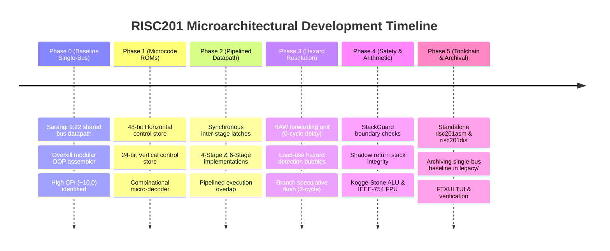

# RISC201 Microarchitectural Development Log & Compliance Matrix

**Course:** CSC-201 Computer Organization & Architecture  
**Project:** RISC201 Microprogrammed Pipelined Processor  
**Team:** Garv (Control Unit & Pipeline Lead), Aditya (Simulator Core & TUI), Atharva (ALU & FPU), Paras (Memory Safety & StackGuard), Saatvik (Assembler & Disassembler)  

---

## 1. Subsystem Responsibilities & Module Map

| Engineering Subsystem | Primary Owner | Production Directory | Key Modules & Implementation Responsibilities |
| :--- | :--- | :--- | :--- |
| **Control Unit & Pipeline** | **Garv (Lead)** | [`control_unit/`](control_unit) | Synchronous 4-stage and 6-stage pipelined datapaths, dual control ROMs (48-bit Horizontal vs. 24-bit Vertical), micro-sequencer for multi-uop instructions, 3-level RAW data forwarding unit, load-use hazard interlocks, and branch speculative flushes. |
| **Simulator Core & TUI** | **Aditya** | [`simulator_core/`](simulator_core) | CPU step execution engine wrapping `PipelineProcessor`, interactive FTXUI full-screen terminal debugger, bounded ring-buffer reverse execution history, and memory inspection hooks. |
| **Arithmetic & Floating-Point** | **Atharva** | [`alu/`](alu), [`fpu/`](fpu) | 32-bit integer ALU (Kogge-Stone parallel prefix adder, Radix-4 Booth multiplier, non-restoring divider), condition flag updates (`Z`, `N`, `C`, `V`), and IEEE-754 single-precision floating-point unit (`f0`–`f15`). |
| **Memory Safety & Firewall** | **Paras** | [`memory_safety/`](memory_safety), [`memory/`](memory) | Physical `MemoryUnit`, hardware `StackGuard` bounds checking on `r14` (`sp`), dedicated `MEMCHK` firewall stage, shadow return stack protection against buffer overflows, and runtime exception framework. |
| **Assembler & Toolchain** | **Saatvik** | [`assembler_disassembler/`](assembler_disassembler) | Standalone two-pass assembler (`risc201asm`), standalone disassembler (`risc201dis`), symbol table resolution, segment directives, and full-descending stack macro expansions. |

---

## 2. Chronological Development Journey: From Single-Bus to Pipeline

### Phase 0: Baseline Single-Bus Microprogrammed Architecture
- **Motivation:** In early project milestones, the team followed standard textbook microprogrammed architectures (such as Sarangi Figure 9.22) and constructed a single-bus datapath (`legacy/datapath/datapath.cpp`, `legacy/common/shared_bus.h`, `legacy/common/internal_registers.h`).
- **Characteristics:** All internal registers (`PC`, `IR`, `MAR`, `MDR`, `A`, `B`, `aluResult`, and the register file) were wired to a single shared 32-bit internal bus.
- **Outcome:** Every macro-instruction required 10+ clock cycles to serialize bus transfers (`PC -> MAR`, `MemRead`, `MDR -> IR`, `A <- rs1`, `B <- rs2`, `ALU -> aluResult`, `MDR -> RegFile`), resulting in a high average CPI of **9.8 to 10.4**.
- **The Modular Assembler:** Concurrently, an over-engineered modular assembler library (`legacy/assembler/`) was constructed with sprawling class hierarchies (`Assembler`, `Disassembler`, `ISA`, `Formats`, `Macros`).
- **Why Retain `legacy/`?** Rather than deleting these components when advancing to pipelining, the team preserved them under [`legacy/`](legacy) to serve as an authentic baseline for comparative cycle benchmarks and to document the microarchitectural evolution of the processor.

### Phase 1: Dual Control Store ROMs
- Replaced hardwired control logic with programmable Control Memory ROM tables:
  - **48-bit Horizontal ROM:** Uncompressed signals driving datapath multiplexers directly with zero decoding delay.
  - **24-bit Vertical ROM:** Field-encoded control word with a fast combinational micro-decoder, reducing control store silicon area by 50% while achieving **100% cycle-for-cycle parity** with the horizontal model.

### Phase 2: Synchronous Pipelining (4-Stage & 6-Stage)
- Eliminated shared bus serialization by introducing dedicated synchronous inter-stage register latches:
  - **4-Stage Pipeline:** `[IF] -> [OF] -> [EX] -> [MA/RW]` (Low latency, 1-cycle load-use penalty, inline memory safety checks).
  - **6-Stage Pipeline:** `[IF] -> [OF] -> [EX] -> [MEMCHK] -> [MA] -> [RW]` (Decoupled hardware memory firewall stage, 2-cycle load-use penalty).

### Phase 3: Hazard Resolution & Forwarding Network
- Implemented [`ForwardingUnit`](control_unit/hazard_unit.h#L26) to bypass fresh results from `EX/MA_RW`, `CHK/MA`, and `MA/RW` back to `EX` input muxes, resolving arithmetic RAW hazards with **0 stall cycles**.
- Implemented [`HazardDetectionUnit`](control_unit/hazard_unit.h#L86) to interlock the pipeline on load-use hazards, freezing the front-end and injecting bubble NOPs into `OF/EX` (1 bubble in 4-stage, 2 bubbles in 6-stage).
- Implemented speculative branch resolution: branches evaluate condition codes in `EX`; on branch taken, younger instructions in `IF/OF` and `OF/EX` are flushed, incurring a 2-cycle penalty.

### Phase 4: Hardware Memory Safety & Shadow Return Stack
- Integrated [`StackGuard`](memory_safety/stack_guard.h) to enforce a bounded 4 KiB stack window (`0x1F000`–`0x20000`, full-descending on `r14`/`sp`).
- Added strict 4-byte word alignment checking (`addr % 4 == 0`) and blocked illegal writes directed below the active stack pointer.
- Implemented an internal hardware **Shadow Return Stack** to mirror return addresses on `CALL` and verify them on `RET`, halting execution with `SHADOW_STACK_MISMATCH` if stack tampering is detected.
- Evaluated and verified across an automated 80-case memory safety test matrix.

### Phase 5: Gate-Level Arithmetic & FPU Integration
- Integrated Atharva's 32-bit Kogge-Stone parallel prefix adder, Radix-4 Booth multiplier, and non-restoring divider.
- Integrated an IEEE-754 single-precision floating-point unit with 16 dedicated floating-point registers (`f0`–`f15`), maintaining clean architectural isolation between integer and floating-point register files.

### Phase 6: Toolchain Streamlining & Interactive FTXUI TUI
- Replaced the overkill modular assembler with two clean, standalone CLI tools: [`assembler_disassembler/asm.cpp`](assembler_disassembler/asm.cpp) (`risc201asm`) and [`assembler_disassembler/disasm.cpp`](assembler_disassembler/disasm.cpp) (`risc201dis`).
- Wired the production `PipelineProcessor` directly into the simulator core ([`simulator_core/core/cpu.h`](simulator_core/core/cpu.h)).
- Built the interactive FTXUI full-screen terminal debugger, displaying live stage latches, GPR and FPR register banks, active stack visualizer, and assembly source code with reverse execution history.

---

## 3. Course Requirements Compliance Matrix

The table below cross-references every requirement from the official course problem statement ([`docs/references/problemStatement.md`](docs/references/problemStatement.md)) against the verified codebase implementation:

| Requirement ID | Problem Statement Requirement | Implementation in RISC201 Codebase | Verification Status |
| :---: | :--- | :--- | :---: |
| **1.1** | Design a 4-stage and 6-stage RISC201 ISA and compare processor behavior. | Implemented in `PipelineProcessor`. Evaluated across Recursive Fibonacci, Matrix Multiply, and Bubble Sort. 4-Stage achieves lower CPI (1.35–1.97); 6-Stage provides higher frequency potential with an isolated memory check stage. | **Verified** |
| **1.2** | Design a corresponding microprogrammed control unit (horizontal or vertical model). | Both implemented: 48-bit Horizontal Control ROM vs. 24-bit Vertical Control ROM with combinational micro-decoder. Evaluated to achieve 100% exact cycle-for-cycle parity. | **Verified** |
| **1.3** | Design a corresponding ALU with efficient arithmetic and logical operations. | 32-bit Kogge-Stone parallel prefix adder, Radix-4 Booth multiplier, non-restoring divider, barrel shifter, and IEEE-754 floating-point unit. | **Verified** |
| **2.1** | Two-pass assembler translating assembly into binary or hexadecimal representations. | Implemented as standalone CLI utility `risc201asm` (`assembler_disassembler/asm.cpp`). Resolves symbol tables, `.text`/`.data` sections, and generates word-aligned hex or binary images. | **Verified** |
| **2.2** | Disassembler reconstructing assembly instructions from word strings. | Implemented as standalone CLI utility `risc201dis` (`assembler_disassembler/disasm.cpp`). Reconstructs symbolic opcodes, operands, and PC-relative jump targets. | **Verified** |
| **2.3** | Interactive CLI interface to simulate register file and instruction pipeline. | Implemented in `Debugger` and `Cpu`. Provides CLI commands (`s`, `mi`, `u`, `reg`, `freg`, `pipe`, `stack`, `mem`). | **Verified** |
| **2.4** | Step-by-step CPU execution simulator with interactive debugger capabilities. | Full-screen interactive terminal debugger using FTXUI (`risc201-sim --tui`). Displays live stage latches, register files, stack visualizer, and synchronized assembly source. | **Verified** |
| **2.5** | Stack preprocessor macro expansion for full-descending stack operations. | Assembler preprocessor expands `PUSH`, `POP`, `SPUSH`, `SPOP` full-descending stack macros on `r14` (`sp`). | **Verified** |
| **2.6** | Stack boundary safety verification & runtime exception framework. | Hardware `StackGuard` bounds checking on `r14` (`sp`), alignment check (`addr % 4 == 0`), illegal write suppression, shadow return stack, and exception framework (`ExceptionCode`). | **Verified** |
| **2.7** | Active stack memory visualizer rendering ASCII stack frames. | Live ASCII stack frame renderer (`stack` and `stack trace` commands) displaying frame markers, saved return addresses, and active stack boundaries. | **Verified** |
| **3** | Add microprogrammed control logic directly to CPU simulator; display microPC state. | Microcode Control Stores directly drive execution in `PipelineProcessor`; live micro-PC and latch states rendered in CLI and TUI. | **Verified** |
| **4** | Optimized RISC201 ALU class integrated into simulator code. | `risc201_alu` linked into simulator engine, driving integer arithmetic, flag generation, and IEEE-754 floating-point operations. | **Verified** |
| **5** | Comprehensive evaluation across 4-stage, 6-stage, horizontal, vertical, and assembly benchmarks. | Evaluated across Recursive Fibonacci, Matrix Multiply with FPU, and Bubble Sort across all permutations, demonstrating 4.8x to 7.3x speedups over the single-bus baseline. | **Verified** |

---

## 4. Test Suite Summary

- **Automated CTest Suites (12/12 Passing):**
  - `risc201-tests`: Core regression test binary.
  - `stack-guard-test`: Standalone StackGuard bounds verification.
  - `memory-unit-test`: Physical MemoryUnit read/write and alignment testing.
  - `stack-visualizer-test`: ASCII stack frame rendering validation.
  - `toolchain-asm-fib` & `toolchain-dis-fib`: Standalone assembly & disassembly of `fib.asm`.
  - `toolchain-asm-fac` & `toolchain-dis-fac`: Standalone assembly & disassembly of `fac.asm`.
  - `toolchain-asm-matmul` & `toolchain-dis-matmul`: Standalone assembly & disassembly of `matmul.asm`.
  - `toolchain-asm-sort` & `toolchain-dis-sort`: Standalone assembly & disassembly of `sort.asm`.
- **Unit & Hardware Safety Matrix (`risc201-tests.exe`):**
  - **48 Unit Tests Passing** covering pipeline forwarding, load-use interlocks, branch flushes, multi-uop execution, reverse step-back, and debugger commands.
  - **80/80 Hardware Safety Permutation Cases Passing** verifying memory protection across all 4 pipeline and control store combinations.
