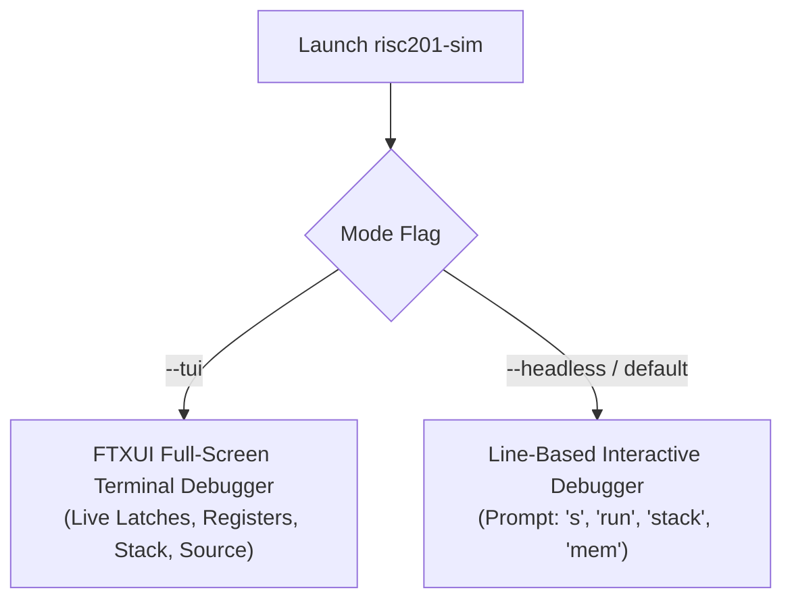

# RISC201 Interactive Terminal User Interface (TUI) & Debugger Manual

**Course:** CSC-201 Computer Organization & Architecture  
**Component:** Full-Screen FTXUI Terminal Debugger & CLI Execution Simulator  
**Source Implementation:** [`simulator_core/ui/tui.cpp`](simulator_core/ui/tui.cpp), [`simulator_core/ui/tui.h`](simulator_core/ui/tui.h), [`simulator_core/core/debugger.h`](simulator_core/core/debugger.h), [`simulator_core/core/cpu.h`](simulator_core/core/cpu.h)  

---

## 1. Overview & Launch Modes

The RISC201 simulator provides an interactive, full-screen terminal user interface powered by **FTXUI**, as well as a headless line-based CLI debugger. 

The TUI wraps the pipelined processor core (`PipelineProcessor`), displaying live inter-stage pipeline latch states, integer and floating-point registers, condition flags, an active ASCII stack visualizer, and original assembly source synchronized with instruction execution.



### Launch Commands
```powershell
# Launch interactive FTXUI TUI in default 4-stage horizontal mode
.\build\risc201-sim.exe --tui

# Launch TUI in 6-stage mode with 24-bit vertical microcode
.\build\risc201-sim.exe --tui --stages 6 --encoding vertical

# Launch headless line-based debugger with a pre-assembled hex image
.\build\risc201-sim.exe --stages 4 --encoding horizontal fib.hex
```

---

## 2. Interactive TUI Display Panes

When launched with `--tui`, the terminal screen is divided into specialized reactive panels:

```
+------------------------------------+------------------------------------+
| SOURCE CODE / DISASSEMBLY (Tab 1)  | LIVE PIPELINE LATCH TELEMETRY      |
| > 0000: mov r1, 10                 | [IF/OF]   PC:0x0004  RAW:0x4110000A    |
|   0004: mov r2, 0                  | [OF/EX]   PC:0x0000  OP:MOV rd:r1      |
|   0008: cmp r1, 0                  | [EX/MA]   ALU:10     rd:r1  FWD:none   |
|   000C: beq done                   | [MA/RW]   WB:10      rd:r1  COMMIT:ok  |
+------------------------------------+------------------------------------+
| GENERAL-PURPOSE REGISTERS (GPR)    | FLOATING-POINT REGISTERS (FPR)     |
| r0:  0x00000000 (0)                | f0:  0x41200000 (10.000)           |
| r1:  0x0000000A (10)               | f1:  0x40000000 (2.000)            |
| r14 (sp): 0x00020000 [STACK TOP]   | f2:  0x41400000 (12.000)           |
| r15 (ra): 0x00000000 [LINK]        | f15: 0x00000000 (0.000)            |
| FLAGS: [Z=0 N=0 C=0 V=0]           | FAULT: NONE                        |
+------------------------------------+------------------------------------+
| ACTIVE STACK VISUALIZER / MEMORY INSPECTOR                              |
| [LIMIT] 0x1F000 | ----------------------------------------------------  |
| [SP]    0x1FFFC | 0x0000000A (Arg 0: 10)                                |
| [BASE]  0x20000 | ==================================== (Initial Top)   |
+-------------------------------------------------------------------------+
| STATUS LINE / HOTKEY HINTS (Press '?' for help, 'q' to quit)            |
+-------------------------------------------------------------------------+
```

### Detailed Pane Breakdown

1. **Source Code / Disassembly Pane:**  
   Displays original assembly source lines or disassembled instruction mnemonics. The highlight arrow (`>`) follows the currently executing instruction word in the pipeline.
2. **Live Pipeline Latch Telemetry Pane:**  
   Displays the actual contents of the synchronous inter-stage pipeline registers on every clock cycle:
   - **4-Stage Mode:** Renders `[IF/OF]`, `[OF/EX]`, and `[EX/MA_RW]`.
   - **6-Stage Mode:** Renders `[IF/OF]`, `[OF/EX]`, `[EX/CHK]`, `[CHK/MA]`, and `[MA/RW]`.
   - Displays whether a stage holds a valid instruction, a bubble/stall, or a flushed NOP; shows live decoded opcodes, forwarded operands, and effective memory addresses.
3. **General-Purpose Register (GPR) Pane:**  
   Renders all 16 integer registers (`r0`–`r15`) in hexadecimal and decimal. Special callouts highlight `r14` (`sp`, stack pointer) and `r15` (`ra`, link register).
4. **Floating-Point Register (FPR) Pane:**  
   Renders all 16 IEEE-754 floating-point registers (`f0`–`f15`), displaying raw 32-bit hex words alongside interpreted decimal floating-point values.
5. **Condition Flags & Exception Status:**  
   Live indicators for Zero (`Z`), Negative (`N`), Carry (`C`), and Signed Overflow (`V`), as well as runtime fault indicators (`FAULT: NONE` or specific exception codes).
6. **Active Stack Frame Visualizer:**  
   ASCII rendering of the 4 KiB stack window (`0x1F000`–`0x20000`), showing frame markers, saved return addresses, and the position of `r14` (`sp`). Pressing `v` toggles between the stack view and a general memory hex dumper.

---

## 3. Workflow: Opening & Assembling Programs

The TUI incorporates direct integration with the standalone assembler [`risc201asm`](assembler_disassembler/asm.cpp):

1. Press `o` while running the TUI.
2. An interactive path input box opens. Enter the relative or absolute path to an assembly file (e.g. `tests/programs/fib.asm`) and press `Enter`.
3. The simulator invokes the standalone `risc201asm` tool via CLI (`risc201asm <file> <file>.hex --hex`).
4. On successful assembly:
   - The CPU is reset to clean initial conditions.
   - The compiled text segment is loaded starting at address `0x00000`.
   - Any static data defined via `.data` is loaded starting at address `0x10000`.
   - The original source code lines are displayed in the source pane, mapped directly to machine code execution addresses.
5. If syntax or semantic assembly errors occur, an error message is surfaced in the status line without disturbing the currently running program.

---

## 4. Forward & Reverse Execution Controls

The debugger features **reversible execution** powered by a bounded circular checkpoint history buffer (up to 4,096 cycles):

- **Single Instruction Step (`s` or `Down` in Source):**  
  Advances the pipeline until the current instruction commits architectural state.
- **Step Backward / Undo (`u` or `Up`):**  
  Restores the previous machine snapshot from the history buffer. GPRs, FPRs, condition flags, pipeline latches, memory writes, and shadow return stack entries are rolled back cleanly.
- **Run to Breakpoint / Completion (`r`):**  
  Runs the pipeline continuously at full speed until a breakpoint is hit, a `HALT` instruction is executed, or a runtime memory exception is raised.
- **Toggle Breakpoint (`b`):**  
  Sets or clears a breakpoint at the highlighted instruction address.

---

## 5. Keyboard Shortcut Reference

| Key | Context | Action |
| :---: | :--- | :--- |
| **`o`** | Global | Open and assemble an assembly source file (`.asm`) |
| **`s`** / **`Down`** | Source Pane | Step one instruction forward |
| **`u`** / **`Up`** | Source Pane | Step one instruction backward (reverse execution) |
| **`r`** | Global | Run / pause execution |
| **`b`** | Global | Toggle breakpoint at current PC |
| **`x`** | Global | Reset CPU and reload program from entry point |
| **`v`** | Memory Pane | Toggle between Stack Visualizer and Memory Hex Dump |
| **`g`** | Memory Pane | Go to byte address in memory dump |
| **`Tab`** | Global | Switch focus between panes |
| **`Shift-Tab`** | Global | Switch focus to previous pane |
| **`?`** / **`F1`** | Global | Toggle help dialogue |
| **`q`** | Global | Quit simulator |

---

## 6. Headless Line-Based CLI Mode

For automated batch testing or environments without interactive terminal support, the simulator can be executed in line mode:

```powershell
# Run headless simulation of a program
.\build\risc201asm.exe tests\programs\fib.asm fib.hex --hex
.\build\risc201-sim.exe --headless fib.hex
```

### Supported CLI Commands
- `s [N]`: Step $N$ instructions forward (default $N=1$).
- `mi [N]`: Step $N$ micro-cycles forward.
- `u [N]`: Undo / step back $N$ steps.
- `r`: Run to breakpoint or completion.
- `b <addr>`: Set breakpoint at hex address.
- `del <addr>`: Remove breakpoint.
- `reg`: Dump general-purpose registers `r0`–`r15` and flags.
- `freg`: Dump floating-point registers `f0`–`f15`.
- `pipe`: Print live pipeline inter-stage latches.
- `mem <addr> [words]`: Dump memory words.
- `stack [words]`: Print ASCII stack visualizer.
- `stack trace [steps] [words]`: Trace stack modifications instruction-by-instruction.
- `q`: Quit.
